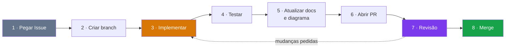

# Como contribuir — ToolRent

> Guia de trabalho da equipe. Leia antes do primeiro commit.

---

## 1. Antes de começar

```bash
git clone https://github.com/kassiods/ToolRent.git
cd ToolRent
```

Confira o ambiente:

```bash
java -version      # precisa ser 21
flutter --version  # 3.44 ou superior
```

O Maven **não** precisa ser instalado: use `./mvnw` (ou `mvnw.cmd` no Windows).

Leia, nesta ordem: [visão do produto](docs/visao-do-produto.md) → [glossário](docs/glossario.md) → o [caso de uso](docs/casos-de-uso.md) da sua história.

---

## 2. O ciclo de trabalho



### 1 · Pegar uma Issue

Escolha uma Issue da sprint atual que atenda a [Definition of Ready](docs/agil/definition-of-ready.md) e **atribua a si mesmo**. Duas pessoas na mesma Issue é retrabalho garantido.

### 2 · Criar a branch

Sempre a partir da `main` atualizada:

```bash
git checkout main
git pull
git checkout -b feat/US07-solicitar-reserva
```

| Prefixo | Quando |
|---|---|
| `feat/` | Funcionalidade nova |
| `fix/` | Correção de defeito |
| `docs/` | Só documentação ou diagrama |
| `test/` | Só testes |
| `refactor/` | Reorganização sem mudar comportamento |

Formato: `prefixo/IDENTIFICADOR-descricao-curta`, usando o ID da história ou do caso de uso.

### 3 · Implementar

Respeite as fronteiras de camada ([ADR 0004](docs/decisoes/0004-regra-de-negocio-na-api.md)):

- Regra de negócio → `api/src/main/java/br/edu/toolrent/api/service/`
- Nunca regra de negócio no Flutter
- Nunca SQL no controller
- Nunca número mágico — parâmetros em `config/`

Commits pequenos, em português, no padrão Conventional Commits:

```bash
git commit -m "feat: adiciona validação de período na reserva"
git commit -m "test: cobre sobreposição parcial de períodos"
git commit -m "docs: atualiza diagrama de estados da reserva"
```

### 4 · Testar

```bash
cd api && ./mvnw clean test
cd app && flutter test && flutter analyze
```

> **Se não conseguir rodar os testes, diga isso no PR.** Nunca marque como testado o que não foi executado.

### 5 · Atualizar documentação e diagrama

Se a implementação mudou comportamento, o documento e o diagrama mudam **no mesmo PR**. Diagrama desatualizado mente sobre o sistema — e a disciplina avalia essa correspondência.

### 6 · Abrir o Pull Request

```bash
git push -u origin feat/US07-solicitar-reserva
```

Use o template, que já pede a rastreabilidade:

```markdown
Closes #12

**Rastreabilidade**
- História: US07
- Caso de uso: UC07 (inclui UC05)
- Regras: RN01, RN02, RN03, RN08
- Diagramas afetados: casos-de-uso.puml, estados-reserva.puml

**O que foi feito**
...

**Como testar**
...
```

Marque a [Definition of Done](docs/agil/definition-of-done.md) item por item.

### 7 · Revisão

**Pelo menos um colega revisa.** Mudanças em regra de negócio, banco ou arquitetura exigem revisão atenta.

Como revisor, verifique:

- [ ] Faz o que a história pede, incluindo fluxos alternativos
- [ ] A regra está na camada certa
- [ ] Os testes cobrem os casos de borda, não só o caminho feliz
- [ ] Nenhuma credencial, `.env` ou arquivo de build no diff
- [ ] Documentação e diagrama atualizados
- [ ] A rastreabilidade está preenchida

Como autor recebendo revisão: comentário não é ataque. Se discordar, explique o raciocínio — não implemente em silêncio algo que você acha errado.

### 8 · Merge

Depois da aprovação e com o CI verde. Apague a branch após o merge.

---

## 3. Segurança antes do commit

> ⛔ **Um segredo commitado permanece no histórico do Git mesmo depois de removido do arquivo.** Apagar não resolve — a chave precisa ser **revogada**.

Sempre, antes de commitar:

```bash
git status      # o que está sendo incluído?
git diff        # o que mudou, linha a linha?
```

**Nunca commite:**

| Item | Onde deveria estar |
|---|---|
| `.env` | Local, a partir do `.env.example` |
| Chave do Supabase | No `.env` |
| `service_role` key | No `.env` da API, **jamais** no app |
| Token do GitHub | No gerenciador de credenciais |
| `api/target/`, `app/build/` | Em lugar nenhum — são gerados |
| Dados reais de pessoas | Em lugar nenhum — use dados fictícios |

Se um segredo vazar: **revogue a chave imediatamente** no painel do Supabase ou do GitHub, avise a equipe e só então limpe o arquivo.

---

## 4. Conflitos de merge

```bash
git checkout main
git pull
git checkout sua-branch
git merge main
```

Resolvendo:

1. **Entenda as duas versões antes de escolher.** Conflito é duas pessoas mexendo no mesmo lugar — as duas tinham um motivo.
2. **Nunca use "aceitar tudo"** sem ler.
3. Em dúvida, chame quem escreveu o outro lado.
4. Depois de resolver, rode os testes de novo.

**Nunca** faça `git push --force` em branch compartilhada. **Nunca** faça `git reset --hard` sem ter certeza do que está descartando.

---

## 5. Padrões de código

### Java (`api/`)

| Regra | Exemplo |
|---|---|
| Classes em `PascalCase` | `LocacaoService` |
| Métodos e variáveis em `camelCase` | `calcularValorBase`, `tarifaDiaria` |
| Constantes em `UPPER_SNAKE_CASE` | `PERCENTUAL_MULTA_PADRAO` |
| Domínio em português | `Locacao`, `Ferramenta`, `calcularEncargos` |
| Dinheiro em `BigDecimal` | nunca `double` ou `float` |
| Estados em `enum` | `EstadoLocacao.EM_ANDAMENTO` |
| Uma responsabilidade por classe | — |

Não capture exceção silenciosamente. Não use `catch (Exception e) {}` para esconder falha. Não use `System.out.println` como estratégia de log.

### Dart (`app/`)

| Regra | Exemplo |
|---|---|
| Classes em `PascalCase` | `CatalogoScreen` |
| Arquivos em `snake_case` | `catalogo_screen.dart` |
| Widget não chama HTTP direto | sempre via `data/repositories/` |
| Sem regra de negócio | ver [ADR 0004](docs/decisoes/0004-regra-de-negocio-na-api.md) |

Rode `flutter analyze` antes do PR.

### SQL (`supabase/`)

Toda mudança de schema é uma **migration nova**, numerada sequencialmente. **Nunca edite uma migration já aplicada** — quem já rodou a versão antiga ficaria com um banco diferente do seu.

---

## 6. Dúvidas

| Dúvida | Onde buscar |
|---|---|
| O que esse termo significa? | [Glossário](docs/glossario.md) |
| Como o sistema deve se comportar? | [Casos de uso](docs/casos-de-uso.md) |
| O que o sistema deve impedir? | [Regras de negócio](docs/regras-de-negocio.md) |
| Onde esse código deve ficar? | [Arquitetura](docs/arquitetura.md) |
| Por que foi feito assim? | [Decisões](docs/decisoes/) |
| Quando está pronto? | [Definition of Done](docs/agil/definition-of-done.md) |

Se a resposta não está em nenhum deles, **pergunte à equipe antes de assumir**. Uma pergunta de dois minutos economiza um dia de retrabalho — e, depois de respondida, vira documentação.
