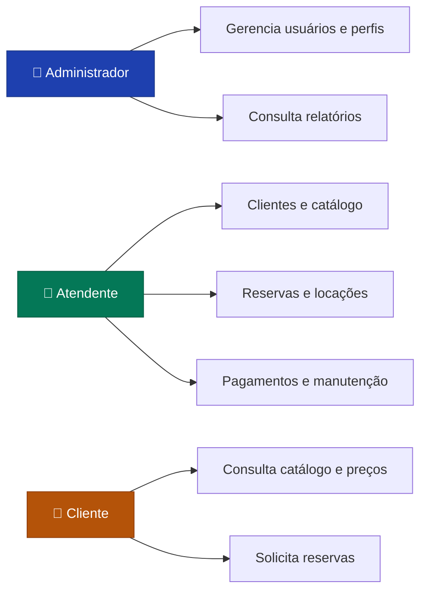
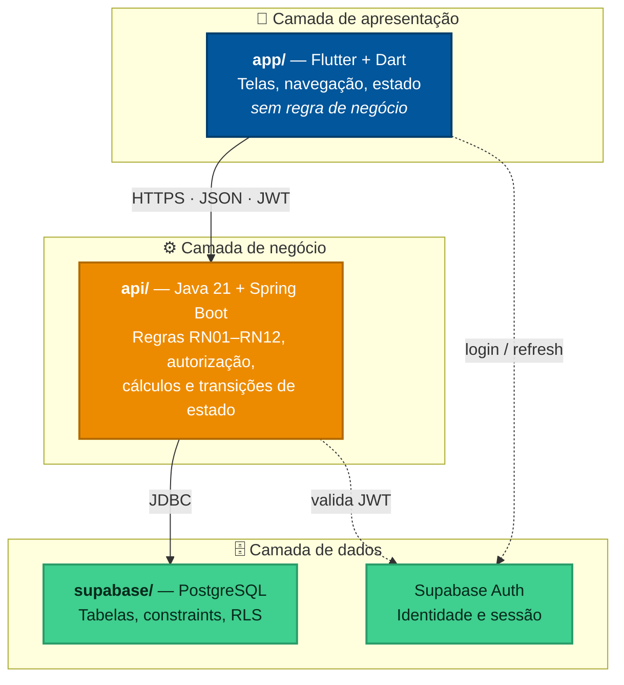

<div align="center">

# 🔧 ToolRent

### Sistema de Locação de Ferramentas

*Controle de catálogo, disponibilidade, reservas, locações, devoluções e pagamentos — sem planilha, sem conflito de agenda, sem conta de cabeça.*

<br>


<br>

**Projeto da disciplina de Análise e Projeto de Sistemas**

Professor: Anthony Irlan Marques Luz

</div>

---

## 📑 Índice

| | |
|---|---|
| [1. Sobre o projeto](#1-sobre-o-projeto) | [5. Estrutura do repositório](#5-estrutura-do-repositório) |
| [2. Atores e perfis](#2-atores-e-perfis) | [6. Como executar](#6-como-executar) |
| [3. Arquitetura](#3-arquitetura) | [7. Fluxo de trabalho](#7-fluxo-de-trabalho) |
| [4. Stack](#4-stack) | [8. Documentação](#8-documentação) |
| | [9. Equipe](#9-equipe) |

---

## 1. Sobre o projeto

O **ToolRent** apoia a operação de uma empresa de locação de ferramentas e equipamentos — o tipo usado em construção civil, manutenção predial e serviços técnicos.

### O problema

Uma locadora pequena normalmente controla tudo em caderno ou planilha. Isso produz quatro falhas recorrentes:

| Problema | Como o ToolRent resolve |
|---|---|
| 🔴 **Reservas conflitantes** — a mesma ferramenta prometida a dois clientes no mesmo período | Consulta de disponibilidade por período (UC05) antes de qualquer reserva ou locação |
| 🔴 **Locação de item indisponível** — ferramenta quebrada ou em manutenção sai para a rua | A situação operacional da ferramenta bloqueia a locação (RN03) |
| 🔴 **Erro de cálculo** — diária, atraso e dano somados de cabeça | Motor de cálculo com memória detalhada (UC12) e precisão decimal (RN12) |
| 🔴 **Falta de histórico** — ninguém sabe quem levou o quê, quando, e em que estado devolveu | Histórico por cliente (UC16) e relatórios operacionais (UC15) |

### Escopo

**16 casos de uso** organizados em 6 fluxos de negócio: autenticação e acesso, cadastros, catálogo e disponibilidade, reserva, locação (formalização → retirada → devolução) e financeiro/relatórios.

> [!NOTE]
> Projeto acadêmico. Todos os dados usados em demonstração são fictícios e estão identificados como tal.

---

## 2. Atores e perfis

O acesso é controlado por autenticação e perfil. **A autorização é validada no servidor** — esconder um botão na interface não é controle de acesso (RN09).



| Ator | Responsabilidade | Casos de uso |
|---|---|---|
| **Administrador** | Governança do sistema: quem entra, com qual perfil, e acompanhamento gerencial | UC01, UC02, UC15 |
| **Atendente** | Operação do dia a dia: do cadastro do cliente ao recebimento do pagamento | UC01, UC03, UC04, UC05, UC08–UC14, UC16 |
| **Cliente** | Autoatendimento: consulta o que existe e solicita o que quer | UC06, UC07 |

> [!IMPORTANT]
> O ator **Técnico de manutenção** foi removido do escopo. A manutenção (UC14) passou a ser responsabilidade do Atendente. A decisão, o motivo e o impacto estão em [`docs/decisoes/0002-remocao-do-ator-tecnico.md`](docs/decisoes/0002-remocao-do-ator-tecnico.md).

### Diagrama de casos de uso

O diagrama é escrito em **Mermaid** e renderizado pelo próprio GitHub — abra
**[`docs/diagramas/sprint-1/casos-de-uso.md`](docs/diagramas/sprint-1/casos-de-uso.md)** e ele aparece na página,
sem imagem a baixar.

📎 Especificação textual dos 16 casos de uso: [`docs/casos-de-uso.md`](docs/casos-de-uso.md) · notação: [ADR 0008](docs/decisoes/0008-mermaid-no-lugar-do-plantuml.md)

---

## 3. Arquitetura

Três camadas, com uma fronteira que importa: **regra de negócio mora na API, nunca no app**.



### Por que a regra fica na API

O app Flutter roda **no dispositivo do usuário** — e tudo que roda no dispositivo do usuário pode ser modificado por ele. Se o cálculo da multa por atraso (RN05) ou a checagem de permissão (RN09) estivesse no Dart, bastaria alterar o app para burlá-los. A API é o único lugar onde a regra é confiável.

O app **pode** validar o mesmo campo para dar retorno imediato ao usuário. Mas essa validação é cortesia visual, não garantia: a API revalida sempre.

### Responsabilidade de cada camada

| Camada | Faz | Não faz |
|---|---|---|
| `app/` | Renderiza telas, coleta entrada, chama a API, exibe erros | Calcular valores, decidir permissão, falar com o banco |
| `api/` | Valida, autoriza, calcula, controla transições de estado, persiste | Formatar visual, decidir layout |
| `supabase/` | Guarda dados, garante integridade referencial, RLS como última linha de defesa | Esconder regra de negócio em trigger |

📎 Detalhamento: [`docs/arquitetura.md`](docs/arquitetura.md)

---

## 4. Stack

| Camada | Tecnologia | Versão | Papel |
|---|---|---|---|
| App | **Flutter / Dart** | 3.44 / 3.12 | Interface multiplataforma (web, desktop, mobile) a partir de um código |
| API | **Java / Spring Boot** | 21 / 3.3 | Regras de negócio, autorização e cálculos |
| Build da API | **Maven** | 3.9+ | Dependências e empacotamento |
| Banco | **Supabase (PostgreSQL)** | 15 | Persistência, integridade referencial e RLS |
| Autenticação | **Supabase Auth** | — | Identidade, sessão e emissão de JWT |
| Versionamento | **Git + GitHub** | — | Código, Issues e Projects |
| Diagramas | **Mermaid** | — | Diagramas UML em texto, renderizados pelo GitHub |

---

## 5. Estrutura do repositório

```
ToolRent/
│
├── 📱 app/                      APP FLUTTER (Dart)
│   ├── lib/
│   │   ├── core/                tema, configuração e cliente HTTP
│   │   ├── domain/              entidades e enums espelhados da API
│   │   ├── data/                repositórios — única porta de saída para a rede
│   │   └── ui/                  telas e widgets
│   ├── pubspec.yaml
│   └── .env.example             modelo de variáveis (o .env real NUNCA é commitado)
│
├── ⚙️ api/                      API JAVA (Spring Boot)
│   ├── src/main/java/br/edu/toolrent/api/
│   │   ├── config/              configuração, segurança e CORS
│   │   ├── domain/              entidades de domínio e enums
│   │   ├── repository/          acesso a dados
│   │   ├── service/             REGRAS DE NEGÓCIO — o coração do sistema
│   │   └── web/                 controllers REST e DTOs
│   ├── src/test/java/           testes automatizados
│   ├── src/main/resources/
│   └── pom.xml
│
├── 🗄️ supabase/                 BANCO DE DADOS
│   ├── migrations/              schema versionado em SQL
│   ├── policies/                políticas de Row Level Security
│   └── README.md                como conectar e aplicar as migrations
│
├── 📚 docs/                     DOCUMENTAÇÃO DO PROJETO
│   ├── visao-do-produto.md
│   ├── casos-de-uso.md          os 16 casos de uso especificados
│   ├── backlog.md               as 16 histórias priorizadas
│   ├── regras-de-negocio.md     RN01 a RN12
│   ├── arquitetura.md
│   ├── glossario.md
│   ├── agil/                    DoR, DoD, roadmap e rastreabilidade
│   ├── sprints/                 plano da sprint em execução, com os pacotes por integrante
│   ├── decisoes/                ADRs — decisões com data e justificativa
│   └── diagramas/               diagramas UML em Mermaid, UMA PASTA POR SPRINT
│       ├── sprint-1/            casos de uso
│       └── sprint-2/            classes e ciclos de vida
│
├── 🤖 arquivos-de-ia/           USO DE IA NO PROJETO
│   ├── guias/                   guia mestre e prompts reutilizáveis
│   └── sessoes/                 transcrições por integrante
│
├── 🔧 .github/                  templates de Issue e PR, integração contínua
├── README.md                    você está aqui
├── CONTRIBUTING.md              como contribuir
└── .gitignore                   barreira contra vazamento de credencial
```

---

## 6. Como executar

### Pré-requisitos

| Ferramenta | Versão mínima | Verificar com |
|---|---|---|
| Flutter SDK | 3.44 | `flutter --version` |
| JDK | **21** | `java -version` |
| Conta Supabase | — | [supabase.com](https://supabase.com) |

> [!TIP]
> **Maven não precisa ser instalado.** O repositório traz o Maven Wrapper: use `./mvnw` (ou `mvnw.cmd` no Windows) e a versão correta do Maven é baixada automaticamente na primeira execução.

> [!WARNING]
> **A API exige JDK 21.** Versões mais novas podem compilar com `--release 21`, mas não são o ambiente alvo da disciplina. Se `java -version` não reportar 21, instale o [Temurin 21](https://adoptium.net/temurin/releases/?version=21) e aponte o `JAVA_HOME` para ele.

<details>
<summary><b>🪟 Conferindo o ambiente no Windows (PowerShell)</b></summary>

```powershell
java -version      # precisa reportar 21
flutter doctor     # resolva o que aparecer com ✗
```

Instalando o JDK 21 pelo winget:

```powershell
winget install --id EclipseAdoptium.Temurin.21.JDK
```

Depois, aponte o `JAVA_HOME` para a pasta instalada e reabra o terminal.

</details>

### 1️⃣ Clonar

```bash
git clone https://github.com/kassiods/ToolRent.git
cd ToolRent
```

### 2️⃣ Configurar o Supabase

Crie um projeto em [supabase.com](https://supabase.com), aplique as migrations de `supabase/migrations/` pelo SQL Editor e copie as credenciais. Passo a passo em [`supabase/README.md`](supabase/README.md).

### 3️⃣ Subir a API

```bash
cd api
cp .env.example .env          # preencha com as credenciais do SEU projeto Supabase
./mvnw clean install          # Windows: mvnw.cmd clean install
./mvnw spring-boot:run
```

A API sobe em `http://localhost:8080`. Para testar: `curl http://localhost:8080/api/health`

### 4️⃣ Rodar o app

```bash
cd app
cp .env.example .env
flutter pub get
flutter run -d chrome          # ou: -d windows / -d android
```

---

## 7. Fluxo de trabalho

### O quadro

O acompanhamento do trabalho fica no Trello:

<div align="center">

### 📋 **[ToolRent — Backlog](https://trello.com/b/m3gakhP8/toolrent-backlog)**

</div>

| Ferramenta | Papel |
|---|---|
| **[GitHub Issues](https://github.com/kassiods/ToolRent/issues)** `#1`–`#16` | Backlog formal: critérios de aceite e rastreabilidade de commit e PR |
| **[Trello](https://trello.com/b/m3gakhP8/toolrent-backlog)** | Quadro Kanban: em que etapa cada história está e quem está nela |
| **[`docs/backlog.md`](docs/backlog.md)** | Fonte da verdade do escopo: prioridade, pontos, caso de uso e sprint |

O GitHub Projects foi descontinuado em favor do Trello — ver [ADR 0009](docs/decisoes/0009-trello-no-lugar-do-github-projects.md). As etiquetas das Issues descrevem a **natureza** do item (`historia`, `P0`/`P1`, `decisao-pendente`); a **sprint** não é etiqueta — vive no quadro e no backlog, um lugar só.

### O diagrama vem antes do código

> [!IMPORTANT]
> **Nenhuma história entra em implementação antes de o diagrama dela estar aprovado em Pull Request.**
> Não é recomendação de estilo: a disciplina exige que cada commit de entrega seja rastreável até
> um elemento de diagrama, e que o código implemente exatamente o que o diagrama especifica.
> Código primeiro transforma o diagrama em documentação retroativa — e o histórico do Git mostra.

```mermaid
flowchart LR
    A["📥 Backlog<br/><i>história existe</i>"] --> B["🎯 Pronto<br/><i>DoR cumprida</i>"]
    B --> C["📐 Diagrama<br/><b>PR só do diagrama</b>"]
    C --> D["🔨 Em andamento<br/><i>agora sim, código</i>"]
    D --> E["🔍 Em revisão<br/><i>PR da implementação</i>"]
    E --> F["✅ Concluído<br/><i>DoD cumprida</i>"]

    C -.->|"diagrama reprovado"| B
    E -.->|"revisão pede ajuste"| D

    classDef etapa fill:#F8FAFC,stroke:#1E40AF,color:#0F172A
    classDef portao fill:#FEF3C7,stroke:#B45309,stroke-width:3px,color:#7C2D12
    class A,B,D,E,F etapa
    class C portao
```



**Toda sprint tem a sua pasta de diagramas** em `docs/diagramas/sprint-N/`, e a implementação
daquela sprint segue o que eles especificam. Hoje: [sprint-1](docs/diagramas/sprint-1/) (casos de
uso) e [sprint-2](docs/diagramas/sprint-2/) (classes, estados da Reserva e da Locação).

O diagrama exigido depende do que a história faz:

| A história… | Exige o diagrama de |
|---|---|
| Cria ou altera entidade de domínio | **Classes** |
| Muda o ciclo de vida de Reserva, Locação ou Manutenção | **Estados** |
| Coordena vários objetos num fluxo (ex.: UC09) | **Sequência** |
| Apenas consulta, sem entidade nem estado novo | Basta o de **casos de uso**, já aprovado |

Regra completa, alternativas descartadas e como ela é aplicada: [ADR 0010](docs/decisoes/0010-diagrama-antes-da-implementacao.md).

### Convenções de branch, commit e revisão

Estão em [`CONTRIBUTING.md`](CONTRIBUTING.md): uma branch por Issue, PR para integrar na `main`, revisão de pelo menos um colega. Nunca commite direto na `main`.

---

## 8. Documentação

| Documento | O que responde |
|---|---|
| [📄 Visão do produto](docs/visao-do-produto.md) | Que problema resolvemos e para quem |
| [📄 Casos de uso](docs/casos-de-uso.md) | Os 16 UC com fluxo principal, alternativos e pós-condições |
| [📄 Backlog](docs/backlog.md) | As 16 histórias, prioridade e critérios de aceite |
| [📄 Regras de negócio](docs/regras-de-negocio.md) | RN01–RN12 e o que ainda depende de decisão da equipe |
| [📄 Arquitetura](docs/arquitetura.md) | Como as camadas conversam e por quê |
| [📄 Glossário](docs/glossario.md) | Vocabulário do domínio: reserva, locação, diária faturável |
| [📁 Decisões (ADRs)](docs/decisoes/) | Toda decisão relevante, com data e alternativas descartadas |
| [📁 Diagramas](docs/diagramas/) | Diagramas UML em Mermaid, **uma pasta por sprint** — a especificação que o código implementa |
| [📁 Sprints](docs/sprints/) | O plano da sprint em execução: pacotes, donos e o que é "pronto" |

---

## 9. Equipe

| Integrante | GitHub |
|---|---|
| Kassio de Sousa Dias | [@kassiods](https://github.com/kassiods) |
| Lincoln Gustavo de Brito Soares | [@Lincoln16yyy](https://github.com/Lincoln16yyy) |
| Victor Rennan Alves Sátiro | [@Rennan-aex](https://github.com/Rennan-aex) |
| Nailan Lucas dos Santos Nobre | [@Nailan-Nobre](https://github.com/Nailan-Nobre) |

**Professor:** Anthony Irlan Marques Luz

O backlog está no [GitHub Issues](https://github.com/kassiods/ToolRent/issues) — uma Issue por história, de `#1` (US01) a `#16` (US16) — e acompanhado no [quadro do Trello](https://trello.com/b/m3gakhP8/toolrent-backlog), onde cada cartão traz caso de uso, regras, sprint, pontos, branch prevista e os diagramas obrigatórios. Ver [§ 7 Fluxo de trabalho](#7-fluxo-de-trabalho).

---

<div align="center">

**ToolRent** · Análise e Projeto de Sistemas · 2026

*Projeto acadêmico, sem fins comerciais.*

</div>
