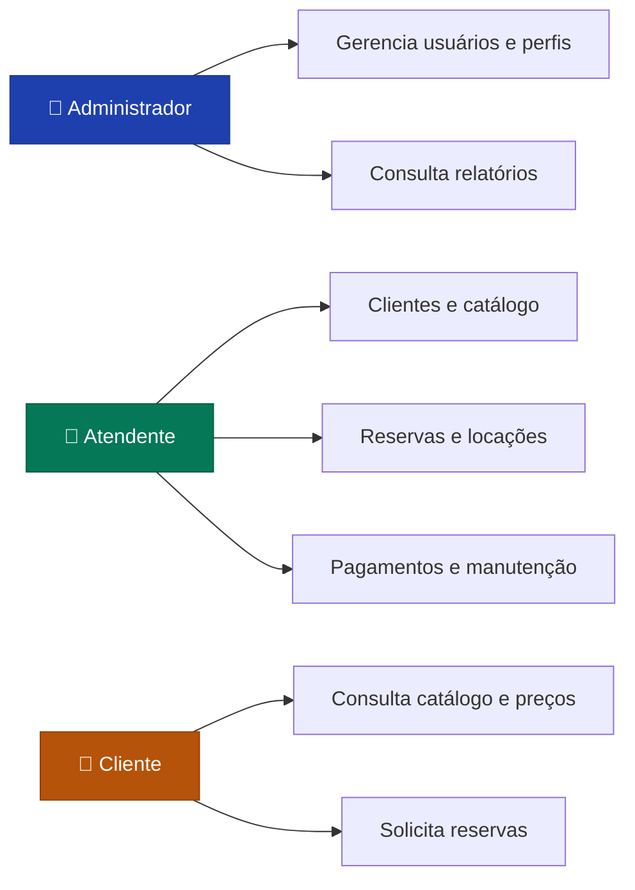
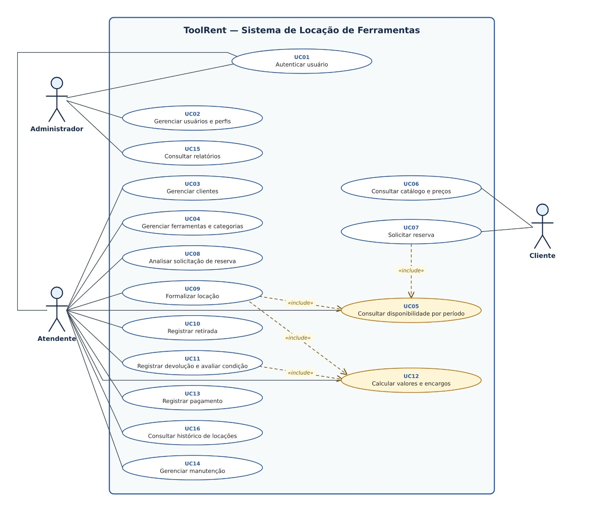
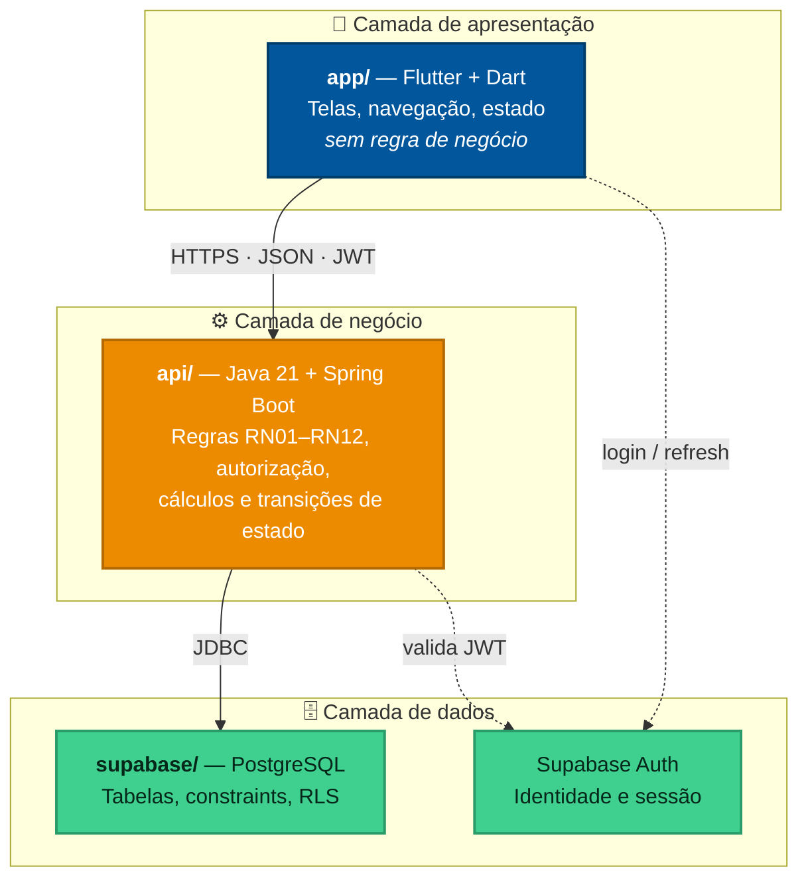
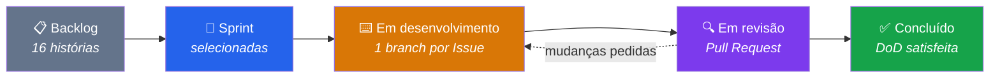

<div align="center">

# 🔧 ToolRent

### Sistema de Locação de Ferramentas

*Controle de catálogo, disponibilidade, reservas, locações, devoluções e pagamentos — sem planilha, sem conflito de agenda, sem conta de cabeça.*

<br>


<br>

**Projeto da disciplina de Análise e Projeto de Sistemas**

Professor: Anthony Irlan Marques Luz

</div>

---

## 📑 Índice

| | | |
|---|---|---|
| [1. Sobre o projeto](#1-sobre-o-projeto) | [5. Estrutura do repositório](#5-estrutura-do-repositório) | [9. Convenções de Git](#9-convenções-de-git) |
| [2. Atores e perfis](#2-atores-e-perfis) | [6. Como executar](#6-como-executar) | [10. Segurança e credenciais](#10-segurança-e-credenciais) |
| [3. Arquitetura](#3-arquitetura) | [7. Documentação](#7-documentação) | [11. Equipe](#11-equipe) |
| [4. Stack](#4-stack) | [8. Metodologia ágil](#8-metodologia-ágil) | [12. Roadmap](#12-roadmap) |

---

## 1. Sobre o projeto

O **ToolRent** apoia a operação de uma empresa de locação de ferramentas e equipamentos — o tipo usado em construção civil, manutenção predial e serviços técnicos.

### O problema

Uma locadora pequena normalmente controla tudo em caderno ou planilha. Isso produz quatro falhas recorrentes:

| Problema | Como o ToolRent resolve |
|---|---|
| 🔴 **Reservas conflitantes** — a mesma ferramenta prometida a dois clientes no mesmo período | Consulta de disponibilidade por período (UC05) antes de qualquer reserva ou locação |
| 🔴 **Locação de item indisponível** — ferramenta quebrada ou em manutenção sai para a rua | A situação operacional da ferramenta bloqueia a locação (RN03) |
| 🔴 **Erro de cálculo** — diária, atraso e dano somados de cabeça | Motor de cálculo com memória detalhada (UC12) e precisão decimal (RN12) |
| 🔴 **Falta de histórico** — ninguém sabe quem levou o quê, quando, e em que estado devolveu | Histórico por cliente (UC16) e relatórios operacionais (UC15) |

### Escopo

**16 casos de uso** organizados em 6 fluxos de negócio: autenticação e acesso, cadastros, catálogo e disponibilidade, reserva, locação (formalização → retirada → devolução) e financeiro/relatórios.

> [!NOTE]
> Projeto acadêmico. Todos os dados usados em demonstração são fictícios e estão identificados como tal.

---

## 2. Atores e perfis

O acesso é controlado por autenticação e perfil. **A autorização é validada no servidor** — esconder um botão na interface não é controle de acesso (RN09).



| Ator | Responsabilidade | Casos de uso |
|---|---|---|
| **Administrador** | Governança do sistema: quem entra, com qual perfil, e acompanhamento gerencial | UC01, UC02, UC15 |
| **Atendente** | Operação do dia a dia: do cadastro do cliente ao recebimento do pagamento | UC01, UC03, UC04, UC05, UC08–UC14, UC16 |
| **Cliente** | Autoatendimento: consulta o que existe e solicita o que quer | UC06, UC07 |

> [!IMPORTANT]
> O ator **Técnico de manutenção** foi removido do escopo. A manutenção (UC14) passou a ser responsabilidade do Atendente. A decisão, o motivo e o impacto estão em [`docs/decisoes/0002-remocao-do-ator-tecnico.md`](docs/decisoes/0002-remocao-do-ator-tecnico.md).

### Diagrama de casos de uso



📎 Fonte versionada: [`docs/diagramas/casos-de-uso.puml`](docs/diagramas/casos-de-uso.puml) · especificação: [`docs/casos-de-uso.md`](docs/casos-de-uso.md)

---

## 3. Arquitetura

Três camadas, com uma fronteira que importa: **regra de negócio mora na API, nunca no app**.



### Por que a regra fica na API

O app Flutter roda **no dispositivo do usuário** — e tudo que roda no dispositivo do usuário pode ser modificado por ele. Se o cálculo da multa por atraso (RN05) ou a checagem de permissão (RN09) estivesse no Dart, bastaria alterar o app para burlá-los. A API é o único lugar onde a regra é confiável.

O app **pode** validar o mesmo campo para dar retorno imediato ao usuário. Mas essa validação é cortesia visual, não garantia: a API revalida sempre.

### Responsabilidade de cada camada

| Camada | Faz | Não faz |
|---|---|---|
| `app/` | Renderiza telas, coleta entrada, chama a API, exibe erros | Calcular valores, decidir permissão, falar com o banco |
| `api/` | Valida, autoriza, calcula, controla transições de estado, persiste | Formatar visual, decidir layout |
| `supabase/` | Guarda dados, garante integridade referencial, RLS como última linha de defesa | Esconder regra de negócio em trigger |

📎 Detalhamento: [`docs/arquitetura.md`](docs/arquitetura.md)

---

## 4. Stack

| Camada | Tecnologia | Versão | Papel |
|---|---|---|---|
| App | **Flutter / Dart** | 3.44 / 3.12 | Interface multiplataforma (web, desktop, mobile) a partir de um código |
| API | **Java / Spring Boot** | 21 / 3.3 | Regras de negócio, autorização e cálculos |
| Build da API | **Maven** | 3.9+ | Dependências e empacotamento |
| Banco | **Supabase (PostgreSQL)** | 15 | Persistência, integridade referencial e RLS |
| Autenticação | **Supabase Auth** | — | Identidade, sessão e emissão de JWT |
| Versionamento | **Git + GitHub** | — | Código, Issues e Projects |
| Diagramas | **PlantUML** | — | Fonte versionada dos diagramas UML |

---

## 5. Estrutura do repositório

```
ToolRent/
│
├── 📱 app/                      APP FLUTTER (Dart)
│   ├── lib/
│   │   ├── core/                tema, configuração e cliente HTTP
│   │   ├── domain/              entidades e enums espelhados da API
│   │   ├── data/                repositórios — única porta de saída para a rede
│   │   └── ui/                  telas e widgets
│   ├── pubspec.yaml
│   └── .env.example             modelo de variáveis (o .env real NUNCA é commitado)
│
├── ⚙️ api/                      API JAVA (Spring Boot)
│   ├── src/main/java/br/edu/toolrent/api/
│   │   ├── config/              configuração, segurança e CORS
│   │   ├── domain/              entidades de domínio e enums
│   │   ├── repository/          acesso a dados
│   │   ├── service/             REGRAS DE NEGÓCIO — o coração do sistema
│   │   └── web/                 controllers REST e DTOs
│   ├── src/test/java/           testes automatizados
│   ├── src/main/resources/
│   └── pom.xml
│
├── 🗄️ supabase/                 BANCO DE DADOS
│   ├── migrations/              schema versionado em SQL
│   ├── policies/                políticas de Row Level Security
│   └── README.md                como conectar e aplicar as migrations
│
├── 📚 docs/                     DOCUMENTAÇÃO DO PROJETO
│   ├── visao-do-produto.md
│   ├── casos-de-uso.md          os 16 casos de uso especificados
│   ├── backlog.md               as 16 histórias priorizadas
│   ├── regras-de-negocio.md     RN01 a RN12
│   ├── arquitetura.md
│   ├── glossario.md
│   ├── agil/                    DoR, DoD, sprints e rastreabilidade
│   ├── decisoes/                ADRs — decisões com data e justificativa
│   └── diagramas/               fontes .puml e imagens
│
├── 🤖 arquivos-de-ia/           USO DE IA NO PROJETO
│   ├── guias/                   guia mestre e prompts reutilizáveis
│   └── sessoes/                 transcrições por integrante
│
├── 🔧 .github/                  templates de Issue e PR, integração contínua
├── README.md                    você está aqui
├── CONTRIBUTING.md              como contribuir
└── .gitignore                   barreira contra vazamento de credencial
```

---

## 6. Como executar

### Pré-requisitos

| Ferramenta | Versão mínima | Verificar com |
|---|---|---|
| Flutter SDK | 3.44 | `flutter --version` |
| JDK | **21** | `java -version` |
| Maven | 3.9 | `mvn -version` |
| Conta Supabase | — | [supabase.com](https://supabase.com) |

> [!WARNING]
> **A API exige JDK 21.** Versões mais novas podem compilar com `--release 21`, mas não são o ambiente alvo da disciplina. Se `java -version` não reportar 21, instale o [Temurin 21](https://adoptium.net/temurin/releases/?version=21) e aponte o `JAVA_HOME` para ele.

<details>
<summary><b>🪟 Conferindo o ambiente no Windows (PowerShell)</b></summary>

```powershell
java -version      # precisa reportar 21
mvn -version       # se "não é reconhecido", o Maven não está no PATH
flutter doctor     # resolva o que aparecer com ✗
```

Se o Maven não estiver instalado: baixe em [maven.apache.org](https://maven.apache.org/download.cgi), extraia a pasta e adicione o subdiretório `bin` ao `Path` nas variáveis de ambiente do Windows.

</details>

### 1️⃣ Clonar

```bash
git clone https://github.com/kassiods/ToolRent-Sistema-de-Loca-o-de-Ferramentas.git
cd ToolRent-Sistema-de-Loca-o-de-Ferramentas
```

### 2️⃣ Configurar o Supabase

Crie um projeto em [supabase.com](https://supabase.com), aplique as migrations de `supabase/migrations/` pelo SQL Editor e copie as credenciais. Passo a passo em [`supabase/README.md`](supabase/README.md).

### 3️⃣ Subir a API

```bash
cd api
cp .env.example .env          # preencha com as credenciais do SEU projeto Supabase
mvn clean install
mvn spring-boot:run
```

A API sobe em `http://localhost:8080`. Para testar: `curl http://localhost:8080/api/health`

### 4️⃣ Rodar o app

```bash
cd app
cp .env.example .env
flutter pub get
flutter run -d chrome          # ou: -d windows / -d android
```

---

## 7. Documentação

| Documento | O que responde |
|---|---|
| [📄 Visão do produto](docs/visao-do-produto.md) | Que problema resolvemos e para quem |
| [📄 Casos de uso](docs/casos-de-uso.md) | Os 16 UC com fluxo principal, alternativos e pós-condições |
| [📄 Backlog](docs/backlog.md) | As 16 histórias, prioridade e critérios de aceite |
| [📄 Regras de negócio](docs/regras-de-negocio.md) | RN01–RN12 e o que ainda depende de decisão da equipe |
| [📄 Arquitetura](docs/arquitetura.md) | Como as camadas conversam e por quê |
| [📄 Glossário](docs/glossario.md) | Vocabulário do domínio: reserva, locação, diária faturável |
| [📁 Decisões (ADRs)](docs/decisoes/) | Toda decisão relevante, com data e alternativas descartadas |
| [📁 Diagramas](docs/diagramas/) | Fontes PlantUML e imagens geradas |

---

## 8. Metodologia ágil

Trabalhamos em **sprints semanais**, com o backlog no GitHub Issues e o quadro no GitHub Projects.



### Rastreabilidade

Todo trabalho tem uma linha contínua de origem — exigência da disciplina e a melhor defesa numa apresentação:

```
História (US) → Caso de uso (UC) → Issue → Branch → Commit → Pull Request → Diagrama
```

A matriz completa está em [`docs/agil/rastreabilidade.md`](docs/agil/rastreabilidade.md).

### Pronto quer dizer pronto

Código escrito **não é** história concluída. Os critérios estão em [`docs/agil/definition-of-done.md`](docs/agil/definition-of-done.md) — em resumo: critérios de aceite satisfeitos, build passando, testes executados, regra na camada certa, documentação e diagramas atualizados, e rastreabilidade registrada.

| Artefato | Onde |
|---|---|
| Definition of Ready | [`docs/agil/definition-of-ready.md`](docs/agil/definition-of-ready.md) |
| Definition of Done | [`docs/agil/definition-of-done.md`](docs/agil/definition-of-done.md) |
| Plano de sprints | [`docs/agil/sprints.md`](docs/agil/sprints.md) |
| Matriz de rastreabilidade | [`docs/agil/rastreabilidade.md`](docs/agil/rastreabilidade.md) |

---

## 9. Convenções de Git

**Branches** — uma por Issue, nomeada pela história ou caso de uso:

```
feat/US07-solicitar-reserva
fix/UC11-devolucao-parcial
docs/UC04-especificacao
```

**Commits** — [Conventional Commits](https://www.conventionalcommits.org/pt-br/), escritos em português:

```
feat: adiciona consulta de disponibilidade por período
fix: impede reserva com período conflitante
docs: documenta atores e casos de uso
test: cobre cálculo de multa por atraso
refactor: move regra de locação do controller para o service
```

Fluxo completo, checklist de revisão e cuidados de merge: [`CONTRIBUTING.md`](CONTRIBUTING.md).

---

## 10. Segurança e credenciais

> [!CAUTION]
> **Nenhuma credencial entra no repositório.** Chave do Supabase, token do GitHub, senha de banco, arquivo `.env` — nada disso. Um segredo commitado continua no histórico do Git mesmo depois de removido do arquivo.

| Regra | Como cumprir |
|---|---|
| Configuração fica em `.env` | Cada integrante cria o seu a partir do `.env.example` |
| `.env` está no `.gitignore` | Já configurado — não remova |
| Antes de todo commit | `git status` e `git diff` — leia o que está indo |
| A chave `service_role` do Supabase | Só na API, **nunca** no app Flutter |
| Senha nunca em texto puro | O Supabase Auth cuida do hash (RN10) |

Se um segredo vazar: **revogue a chave imediatamente** no painel do Supabase ou do GitHub e avise a equipe. Trocar a chave é o que resolve — apagar o arquivo não.

---

## 11. Equipe

| Integrante | GitHub |
|---|---|
| Kassio de Sousa Dias | [@kassiods](https://github.com/kassiods) |
| Lincoln Gustavo de Brito Soares | [@Lincoln16yyy](https://github.com/Lincoln16yyy) |
| Victor Rennan Alves Sátiro | [@Rennan-aex](https://github.com/Rennan-aex) |
| Nailan Lucas dos Santos Nobre | [@Nailan-Nobre](https://github.com/Nailan-Nobre) |

**Professor:** Anthony Irlan Marques Luz

---

## 12. Roadmap

| Sprint | Entrega | Status |
|---|---|---|
| **0** | Repositório, estrutura, README e documentação base | ✅ Concluído |
| **1** | Casos de uso, diagrama de casos de uso e backlog no GitHub | 🟡 Em andamento |
| **2** | Diagrama de classes e modelo de dados no Supabase | ⬜ Planejado |
| **3** | Autenticação, perfis e autorização (UC01, UC02) | ⬜ Planejado |
| **4** | Catálogo, clientes e disponibilidade (UC03–UC06) | ⬜ Planejado |
| **5** | Reservas e locação (UC07–UC10) | ⬜ Planejado |
| **6** | Devolução, cálculos e pagamentos (UC11–UC13) | ⬜ Planejado |
| **7** | Manutenção, relatórios e histórico (UC14–UC16) | ⬜ Planejado |
| **8** | Testes de integração, revisão de diagramas e entrega final | ⬜ Planejado |

Detalhamento em [`docs/agil/sprints.md`](docs/agil/sprints.md).

---

<div align="center">

**ToolRent** · Análise e Projeto de Sistemas · 2026

*Projeto acadêmico, sem fins comerciais.*

</div>
