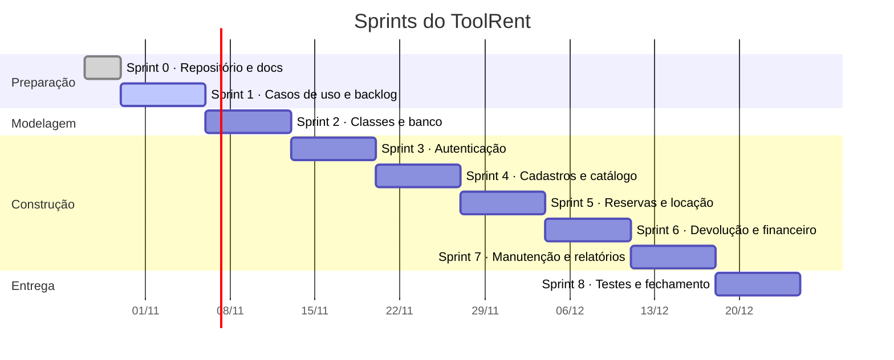

# Plano de Sprints — ToolRent

> **Sprints semanais.** O calendário oficial vem do professor — as datas abaixo são a organização interna da equipe e devem ser ajustadas quando o cronograma oficial for divulgado.

---

## Ritmo da equipe

| Cerimônia | Quando | Duração | Objetivo |
|---|---|---|---|
| **Planejamento** | Início da sprint | 30 min | Escolher as histórias e distribuir |
| **Sincronização** | 2× por semana | 10 min | O que fiz, o que farei, o que me trava |
| **Revisão** | Fim da sprint | 20 min | Demonstrar o que ficou pronto |
| **Retrospectiva** | Fim da sprint | 15 min | O que manter, o que mudar |

Capacidade estimada: **10 a 13 pontos por sprint** com 4 integrantes em disciplina paralela. Ajustar após duas sprints com dados reais.

---

## Roadmap

---

## Sprint 0 — Fundação ✅

**Objetivo:** ter um repositório que qualquer integrante consegue clonar e entender.

| Entrega | Status |
|---|---|
| Repositório criado com estrutura de pastas | ✅ |
| README explicando projeto, stack e execução | ✅ |
| `.gitignore` protegendo credenciais | ✅ |
| Documentação base (visão, casos de uso, backlog, regras, arquitetura, glossário) | ✅ |
| Templates de Issue e PR | ✅ |
| Esqueleto do app Flutter (analisado e testado) | ✅ |
| Esqueleto da API Java (build verificado, 2 testes) | ✅ |
| Migration inicial do Supabase | 🟡 rascunho, a confirmar na Sprint 2 |

---

## Sprint 1 — Casos de uso 🟡

**Objetivo:** entregar a documentação de requisitos exigida na primeira entrega da disciplina.

| Tarefa | Status |
|---|---|
| Criar as 16 Issues no GitHub a partir do backlog | ✅ #1 a #16 |
| Adicionar integrantes e professor como colaboradores | ✅ |
| Aprovação do professor para a mudança de stack | ✅ ADR 0001 |
| Revisar os 16 casos de uso com a equipe | ⬜ |
| Gerar a imagem do diagrama a partir do `.puml` | ✅ [`casos-de-uso.jpg`](../diagramas/casos-de-uso.jpg) |
| Configurar o GitHub Project com as colunas do fluxo | ✅ [Project #2](https://github.com/users/kassiods/projects/2) |
| **Resolver as decisões pendentes #1, #2 e #5** | 🟡 propostas em [ADR 0005](../decisoes/0005-login-proprio-do-cliente.md), [0006](../decisoes/0006-reserva-bloqueia-apenas-apos-aprovacao.md) e [0007](../decisoes/0007-locacao-presencial-sem-reserva.md) — aguardam aprovação |
| Revisar o documento antes da entrega | ⬜ |

**Critério de conclusão:** documento e diagrama coerentes entre si, 16 Issues criadas, colaboradores adicionados.

---

## Sprint 2 — Modelagem

**Objetivo:** diagrama de classes e banco de dados correspondentes.

| Tarefa | Depende de |
|---|---|
| Diagrama de classes de domínio (9 a 13 classes) | Sprint 1 |
| Diagrama de estados da `Locacao` | Sprint 1 |
| Migration do schema no Supabase | Diagrama de classes |
| Políticas de RLS | Schema |
| Dados de demonstração fictícios | Schema |

> ⚠️ O enunciado limita o domínio a **9–13 classes**. Candidatas: `Usuario`, `Perfil`, `Cliente`, `Categoria`, `Ferramenta`, `Reserva`, `Locacao`, `ItemLocacao`, `Devolucao`, `Pagamento`, `Manutencao` — 11 classes. Classes de UI, DTO, service e repository **não** contam como domínio.

---

## Sprint 3 — Autenticação · 10 pontos

| História | Pontos |
|---|---|
| US01 — Autenticar-se | 5 |
| US02 — Gerenciar usuários e perfis | 5 |

**Por que primeiro:** todo o resto depende de saber quem é o usuário. RN09 atravessa todos os casos de uso.

**Entrega demonstrável:** login funcionando, com menus diferentes por perfil e endpoint protegido retornando 403.

---

## Sprint 4 — Cadastros e catálogo · 19 pontos

| História | Pontos |
|---|---|
| US03 — Cadastrar clientes | 3 |
| US04 — Cadastrar ferramentas e categorias | 5 |
| US05 — Consultar disponibilidade | 8 |
| US06 — Consultar catálogo | 3 |

> ⚠️ **19 pontos passa da capacidade estimada.** Se a velocidade medida nas Sprints 2 e 3 não confirmar essa capacidade, mova US06 para a Sprint 5.

**Atenção:** US05 é a primeira história com lógica real (sobreposição de períodos). Reserve tempo para os testes de borda.

---

## Sprint 5 — Reservas e locação · 21 pontos

| História | Pontos |
|---|---|
| US07 — Solicitar reserva | 5 |
| US08 — Aprovar ou recusar reservas | 5 |
| US09 — Formalizar locação | 8 |
| US10 — Registrar retirada | 3 |

**Entrega demonstrável:** fluxo completo do pedido do cliente até a ferramenta saindo da loja.

---

## Sprint 6 — Devolução e financeiro · 26 pontos

| História | Pontos |
|---|---|
| US11 — Registrar devolução | 8 |
| US12 — Calcular valores e encargos | 13 |
| US13 — Registrar pagamentos | 5 |

> ⛔ **A sprint mais pesada do projeto.** Duas providências antes de começar:
> 1. **Resolver as decisões #3, #4 e #6** — sem elas a US12 não pode ser implementada
> 2. **Quebrar a US12** em pelo menos 3 histórias menores

---

## Sprint 7 — Manutenção e relatórios · 16 pontos

| História | Pontos |
|---|---|
| US14 — Gerenciar manutenções | 5 |
| US15 — Consultar relatórios | 8 |
| US16 — Consultar histórico | 3 |

---

## Sprint 8 — Fechamento

| Tarefa |
|---|
| Testes de integração dos fluxos principais |
| Revisão de todos os diagramas contra o código entregue |
| Revisão da documentação |
| Verificação de execução limpa a partir de um clone novo |
| Preparação da apresentação |

**O teste decisivo:** clonar o repositório numa máquina limpa e conseguir subir o sistema seguindo apenas o README. Se não funcionar, o README está incompleto.

---

## Riscos

| Risco | Impacto | Mitigação |
|---|---|---|
| Decisões pendentes travarem a Sprint 6 | Alto | Resolver #3 e #4 até o fim da Sprint 4 |
| US12 ser maior que o estimado | Alto | Quebrar em 3+ histórias antes de começar |
| Sprints 4, 5 e 6 acima da capacidade | Médio | Medir velocidade real nas Sprints 2 e 3 e replanejar |
| Diagrama divergir do código | Alto | Atualizar o diagrama **no mesmo PR** da implementação |
| Ambiente de desenvolvimento inconsistente | Baixo | Maven Wrapper (`./mvnw`) elimina a instalação do Maven; resta conferir JDK 21 e Flutter em cada máquina |
| Credencial do Supabase vazar em commit | Alto | `.gitignore` configurado e `git diff` antes de cada commit |
