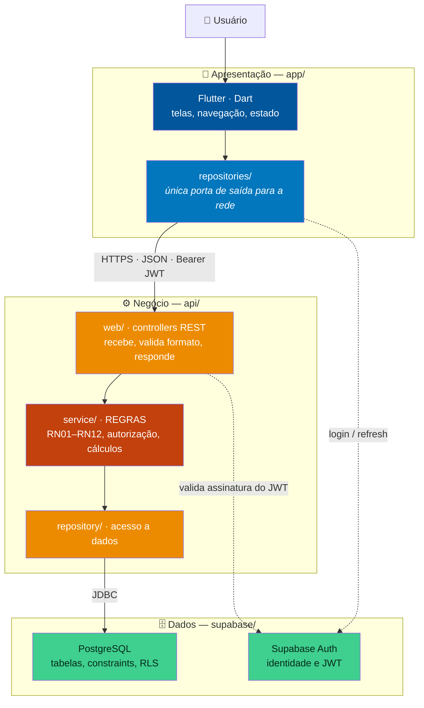
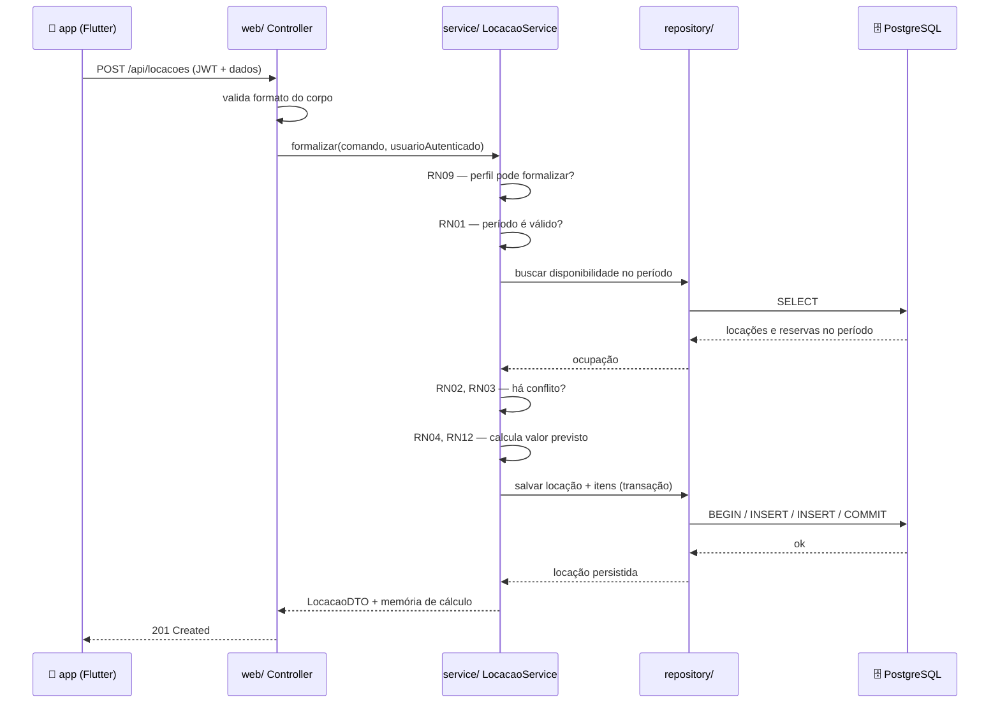

# Arquitetura — ToolRent

> **Versão:** 1.0 · 27/10/2026

---

## 1. Visão geral

Três camadas, com uma fronteira inegociável: **regra de negócio mora na API**.



---

## 2. Por que a regra fica na API

O app Flutter roda no **dispositivo do usuário**. Tudo que roda no dispositivo do usuário pode ser inspecionado e alterado por ele.

Se o cálculo da multa (RN05) estivesse no Dart, um cliente poderia zerá-la. Se a checagem de permissão (RN09) estivesse no Dart, bastaria remover um `if` para acessar a tela de administração. Esconder um botão **não é** controle de acesso.

O app **pode** validar os mesmos campos para dar retorno imediato — avisar que a data final é anterior à inicial antes de gastar uma viagem de rede é boa experiência. Mas essa validação é cortesia visual. **A API revalida tudo, sempre.**

### A regra na prática

| Pergunta | Resposta |
|---|---|
| Posso calcular o valor da locação no Flutter para exibir mais rápido? | Pode exibir uma **estimativa**, marcada como tal. O valor que vale é o que a API devolve. |
| Posso esconder o menu de relatórios para quem não é admin? | Pode e deve — mas o endpoint também precisa retornar 403. |
| Posso confiar no `clienteId` que o app mandou? | Não. A API deriva a identidade do JWT, nunca do corpo da requisição. |

---

## 3. Camadas e responsabilidades

### `app/` — Flutter

```
lib/
├── core/           tema, configuração, cliente HTTP, tratamento de erro
├── domain/         entidades e enums espelhados da API (objetos burros)
├── data/
│   └── repositories/   ÚNICA camada que fala com a rede
└── ui/
    ├── screens/    telas
    └── widgets/    componentes reutilizáveis
```

**Regras:**

- Nenhum widget chama HTTP diretamente — sempre via `repositories/`
- `domain/` não tem lógica de negócio, só estrutura de dados
- Erro de rede vira mensagem compreensível, nunca stack trace na tela

### `api/` — Spring Boot

```
src/main/java/br/edu/toolrent/api/
├── config/         segurança, CORS, beans, parâmetros de negócio
├── domain/         entidades e enums do domínio
├── repository/     acesso a dados
├── service/        REGRAS DE NEGÓCIO — o coração
└── web/            controllers REST e DTOs
```

**Regras:**

- `web/` não contém regra — recebe, delega a `service/`, responde
- `service/` não conhece HTTP — não recebe `HttpServletRequest` nem devolve `ResponseEntity`
- `repository/` não contém regra — só persistência
- Entidade de domínio não contém SQL
- Toda operação que altera várias tabelas roda em transação
- Nenhum valor de negócio (taxa, percentual, limite) aparece literal no código — fica em `config/`

### `supabase/` — PostgreSQL

```
supabase/
├── migrations/     schema versionado, numerado e idempotente
└── policies/       Row Level Security
```

**Regras:**

- Toda mudança de schema é uma migration nova, nunca edição de migration já aplicada
- Constraints de integridade no banco, não só no código
- RLS é a **última** linha de defesa, não a primeira — a autorização principal é da API
- Nenhuma regra de negócio escondida em trigger

---

## 4. Fluxo de uma requisição

Exemplo: o atendente formaliza uma locação (UC09).



Repare: o controller não decide nada de negócio, e o service não sabe que existe HTTP.

---

## 5. Autenticação

O Supabase Auth é o provedor de identidade. O fluxo:

1. O app envia e-mail e senha ao Supabase Auth
2. O Supabase devolve um **JWT** assinado
3. O app guarda o token e o envia em cada requisição: `Authorization: Bearer <token>`
4. A API **valida a assinatura** do JWT e extrai o identificador do usuário
5. A API busca o perfil desse usuário e autoriza a operação

**A API nunca confia em identificador vindo no corpo da requisição.** A identidade sai sempre do token.

A chave `service_role` do Supabase fica **exclusivamente** na API. Se ela for parar no app Flutter, qualquer usuário terá acesso irrestrito ao banco.

---

## 6. Tratamento de erro

| Situação | HTTP | O que o app mostra |
|---|---|---|
| Dado inválido | 400 | Campo com problema destacado |
| Sem token ou token expirado | 401 | Redireciona para o login |
| Perfil sem permissão | 403 | "Você não tem permissão para esta ação" |
| Registro não encontrado | 404 | "Não encontrado" |
| Violação de regra de negócio | 409 | A mensagem da regra, em português |
| Erro interno | 500 | Mensagem genérica; o detalhe vai para o log |

**Nunca** exibir stack trace, SQL ou nome de tabela ao usuário. **Nunca** registrar senha ou token no log.

---

## 7. Decisões registradas

| ADR | Decisão |
|---|---|
| [0001](decisoes/0001-stack-flutter-java-supabase.md) | Flutter + Java/Spring Boot + Supabase |
| [0002](decisoes/0002-remocao-do-ator-tecnico.md) | Remoção do ator Técnico de manutenção |
| [0003](decisoes/0003-estado-atrasada-derivado.md) | `ATRASADA` como estado derivado |
| [0004](decisoes/0004-regra-de-negocio-na-api.md) | Regra de negócio exclusivamente na API |
