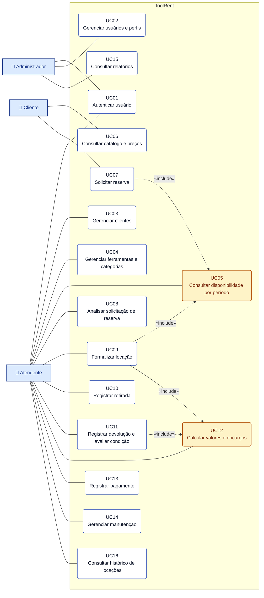

# Diagrama de Casos de Uso — ToolRent

> **Esta é a fonte do diagrama.** O bloco Mermaid abaixo é renderizado pelo próprio GitHub —
> não existe imagem a gerar nem ferramenta a instalar. Ao alterar o diagrama, altere este
> arquivo e atualize [`../casos-de-uso.md`](../casos-de-uso.md) no mesmo PR.
>
> Documento correspondente: [`docs/casos-de-uso.md`](../casos-de-uso.md) (versão 2.0)
> Notação: ver [ADR 0008](../decisoes/0008-mermaid-no-lugar-do-plantuml.md).

**3 atores · 16 casos de uso · 3 CRUD puro**

## Legenda

| Elemento | Significado |
|---|---|
| Retângulo azul-claro | Ator — perfil de usuário que interage com o sistema |
| Caixa arredondada branca | Caso de uso |
| Caixa arredondada âmbar | Caso de uso **incluído** por outros (UC05 e UC12) |
| Linha contínua | Associação ator ↔ caso de uso |
| Seta tracejada `«include»` | Comportamento sempre executado pelo caso de uso de origem |
| Moldura **ToolRent** | Fronteira do sistema |

## Correspondência com os atores

| Ator | Casos de uso |
|---|---|
| **Administrador** | UC01, UC02, UC15 |
| **Atendente** | UC01, UC03, UC04, UC05, UC08–UC14, UC16 |
| **Cliente** | UC06, UC07 |

## Relações `«include»` declaradas

| Origem | Destino | Por quê |
|---|---|---|
| UC07 Solicitar reserva | UC05 Consultar disponibilidade | Não se solicita reserva sem antes verificar o período |
| UC09 Formalizar locação | UC05 Consultar disponibilidade | A formalização revalida a disponibilidade no momento do contrato |
| UC09 Formalizar locação | UC12 Calcular valores | O contrato nasce com o valor base calculado |
| UC11 Registrar devolução | UC12 Calcular valores | A devolução recalcula atraso e danos |

Não há `«extend»` no escopo: nenhum caso de uso atual é extensão opcional de outro.
