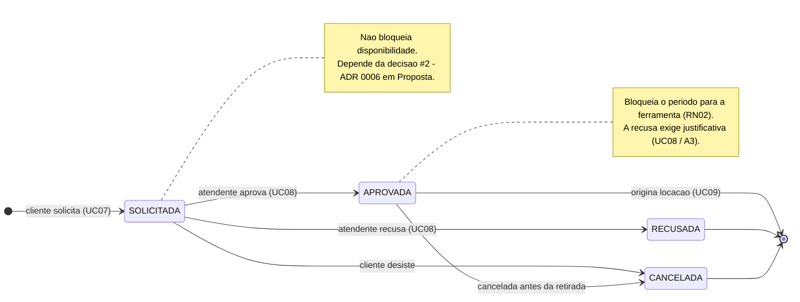

# Diagrama de Estados — Reserva

> Especificação do ciclo de vida da `Reserva`. Entrega da Sprint 2 —
> ver [`docs/sprints/sprint-2.md`](../sprints/sprint-2.md).
>
> **As transições válidas são exatamente estas.** Qualquer outra é rejeitada na camada de
> serviço, não escondida na interface (RN08, RN09).

## Transições

| De | Para | Gatilho | Quem | Regras |
|---|---|---|---|---|
| — | `SOLICITADA` | Cliente solicita reserva | Cliente | RN01 período válido · RN03 ferramenta disponível |
| `SOLICITADA` | `APROVADA` | Atendente aprova | Atendente | RN02 sem conflito no período · RN09 |
| `SOLICITADA` | `RECUSADA` | Atendente recusa | Atendente | Justificativa obrigatória · RN09 |
| `SOLICITADA` | `CANCELADA` | Cliente desiste | Cliente | — |
| `APROVADA` | `CANCELADA` | Cancelamento antes da retirada | Atendente ou Cliente | Libera o período reservado |
| `APROVADA` | *(final)* | Reserva vira locação | Atendente | UC09 · a reserva não volta a estados anteriores |

## Transições proibidas

Estas **não** existem e devem ser rejeitadas com erro claro:

- `RECUSADA` → qualquer coisa — decisão tomada não se desfaz; o cliente abre nova reserva
- `CANCELADA` → qualquer coisa — mesma razão
- `SOLICITADA` → formalizar locação direto, sem passar por `APROVADA`
- `APROVADA` → `RECUSADA` — recusar depois de aprovar é cancelar, não recusar

## O que depende de decisão da equipe

> ⚠️ **Decisão #2** — se a reserva `SOLICITADA` bloqueia ou não a disponibilidade
> ([ADR 0006](../decisoes/0006-reserva-bloqueia-apenas-apos-aprovacao.md), 🟡 Proposta).
>
> **Não muda os estados nem as transições deste diagrama** — muda apenas a regra de
> disponibilidade (RN02, UC05), que é Sprint 4. O diagrama vale nos dois cenários.
