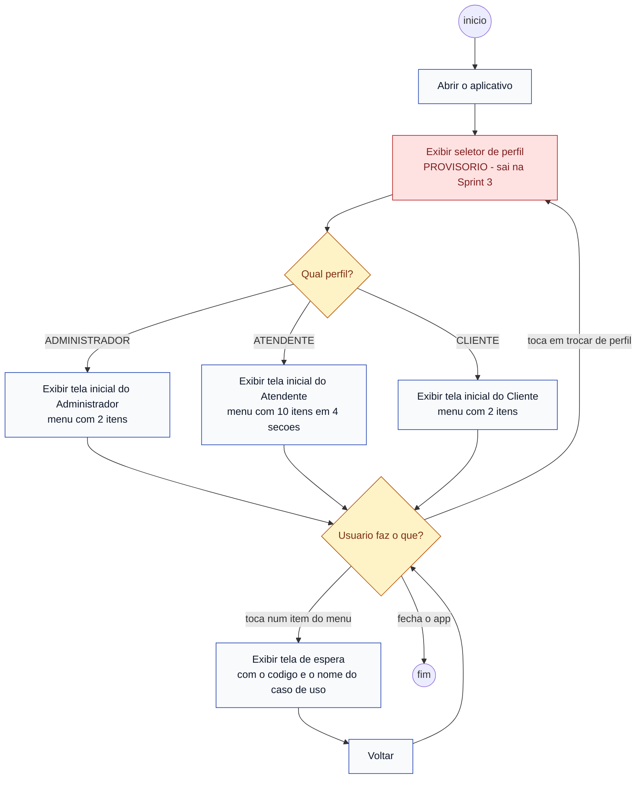

# Diagrama de Atividades — Da abertura do app à tela inicial de cada perfil

> **Um dos quatro diagramas UML do capítulo 4** de *Engenharia de Software Moderna*, de Marco
> Tulio Valente — ver [ADR 0015](../../decisoes/0015-diagramas-conforme-engenharia-de-software-moderna.md).
>
> Entrega da Sprint 2, Pacote 2 — ver [`docs/sprints/sprint-2.md`](../../sprints/sprint-2.md).
>
> **Para que serve:** representar o processo e o fluxo de execução em alto nível — o caminho que
> o usuário percorre, com os pontos de decisão.
>
> ⚠️ **Sem back-end.** Nenhuma tela desta sprint chama a API, lê banco ou autentica.

## Notação

O livro desenha ação como retângulo e usa elementos de controle — decisão, merge, fork, join —
com fichas percorrendo o fluxo. Aqui: `flowchart` com losango para decisão, círculo para início
e fim.

## Legenda

| Elemento | Significa |
|---|---|
| ⚪ círculo | Início e fim do fluxo |
| ⬜ retângulo | Uma ação |
| 🔶 losango | Ponto de decisão |
| 🔴 vermelho | Elemento **provisório**, que sai na Sprint 3 |

## O seletor de perfil não é autenticação

Está marcado em vermelho de propósito. Enquanto não existe login (UC01, Sprint 3), o app precisa
de alguma forma de abrir cada uma das três telas — e essa forma é uma escolha direta, sem senha.

**Ele não controla acesso a nada.** Na Sprint 3, o losango `Qual perfil?` deixa de ser uma
pergunta ao usuário e passa a ser decidido pelo perfil que vem do token: o fluxo do diagrama
continua o mesmo, só muda quem responde à decisão.

## Os três destinos, item a item

As três telas têm a mesma estrutura — cabeçalho, menu de ações, sair — e diferem só no conteúdo
do menu. O conteúdo sai dos casos de uso de cada ator
([casos de uso § 3](../../casos-de-uso.md#3-casos-de-uso-identificados)).

### Administrador — 2 itens

| Ordem | Rótulo | Ícone Material | Caso de uso |
|---|---|---|---|
| 1 | Usuários e perfis | `Icons.manage_accounts_outlined` | UC02 |
| 2 | Relatórios | `Icons.bar_chart_outlined` | UC15 |

### Atendente — 10 itens, em 4 seções

A ordem **é** a do fluxo operacional — cadastrar, consultar, locar, apoiar — não a alfabética.

| Seção | Ordem | Rótulo | Ícone Material | Caso de uso |
|---|---|---|---|---|
| Cadastros | 1 | Clientes | `Icons.people_outline` | UC03 |
| Cadastros | 2 | Ferramentas e categorias | `Icons.handyman_outlined` | UC04 |
| Disponibilidade e reservas | 3 | Consultar disponibilidade | `Icons.event_available_outlined` | UC05 |
| Disponibilidade e reservas | 4 | Analisar reservas | `Icons.fact_check_outlined` | UC08 |
| Locação | 5 | Formalizar locação | `Icons.assignment_turned_in_outlined` | UC09 |
| Locação | 6 | Registrar retirada | `Icons.outbox_outlined` | UC10 |
| Locação | 7 | Registrar devolução | `Icons.assignment_return_outlined` | UC11 |
| Locação | 8 | Registrar pagamento | `Icons.payments_outlined` | UC13 |
| Apoio | 9 | Manutenções | `Icons.build_circle_outlined` | UC14 |
| Apoio | 10 | Histórico do cliente | `Icons.history` | UC16 |

**Dez, não onze.** O Atendente aparece em onze linhas da tabela de casos de uso, mas
**UC12 — Calcular valores e encargos não tem item de menu**: é `«include»` de UC09 e UC11
([casos de uso § 3](../../casos-de-uso.md#relações-entre-casos-de-uso)), acontece dentro desses
fluxos e nunca sozinho. Dar a ele um botão inventaria uma relação que o diagrama de casos de uso
não tem.

### Cliente — 2 itens

| Ordem | Rótulo | Ícone Material | Caso de uso |
|---|---|---|---|
| 1 | Catálogo e preços | `Icons.storefront_outlined` | UC06 |
| 2 | Solicitar reserva | `Icons.add_shopping_cart_outlined` | UC07 |

**Dois, e nada além.** Não é omissão — é o que a documentação aprovada diz. O Cliente *consulta o
catálogo e os preços e solicita reservas*
([casos de uso § 2](../../casos-de-uso.md#2-atores-do-sistema)). Em particular:

| O que **não** entra | Por quê |
|---|---|
| "Minhas reservas" | Não existe caso de uso do Cliente para isso. UC16, histórico, tem o **Atendente** como ator |
| "Meus pagamentos" | UC13 é do Atendente |
| "Consultar disponibilidade" | UC05 é do Atendente. O Cliente alcança a disponibilidade **dentro** de UC07, por `«include»` |

Se a equipe quiser uma tela de "minhas reservas", **o caminho é criar o caso de uso primeiro**,
no documento e no diagrama de casos de uso — não acrescentar um botão aqui.

## Fora do escopo, de propósito

- As telas de destino de cada caso de uso — cada uma entra na sua sprint
- Autenticação, API, banco, regra de negócio
- Cor literal no widget: tudo sai de `core/app_theme.dart`
