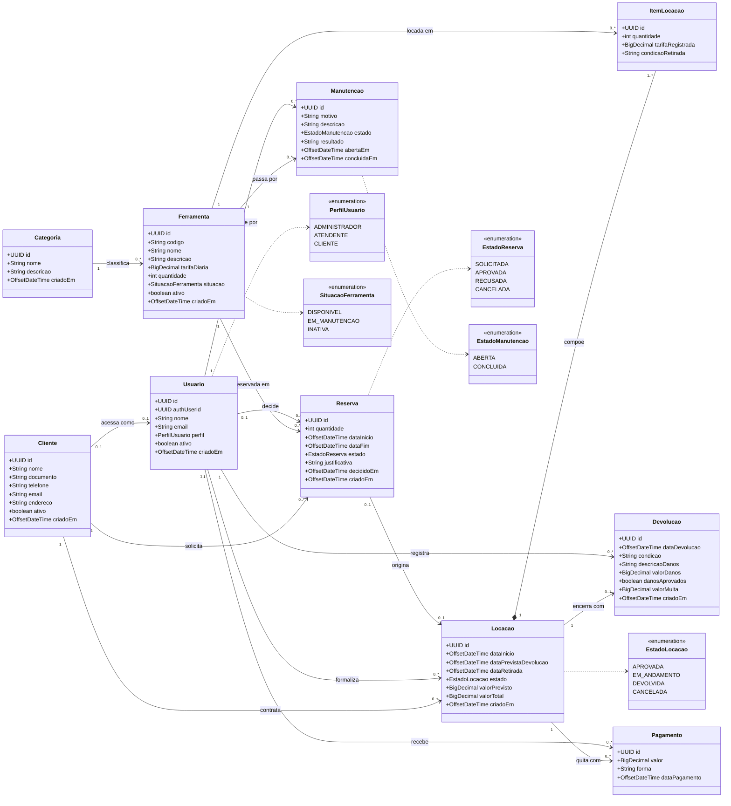

# Diagrama de Classes de Domínio — ToolRent

> **Esta é a especificação das classes de domínio da Sprint 2.** O código em
> `api/src/main/java/br/edu/toolrent/api/domain/` deve corresponder exatamente a este diagrama.
> Entrega da Sprint 2 — ver [`docs/sprints/sprint-2.md`](../../sprints/sprint-2.md).
>
> Alterou o modelo? Altere este arquivo **no mesmo PR** ([ADR 0010](../../decisoes/0010-diagrama-antes-da-implementacao.md)).

**10 classes de domínio** — dentro do intervalo de 9 a 13 exigido pela disciplina.
Enumerações são tipos de valor e não contam como classe de domínio.

## Pontos de atenção na implementação

| # | Ponto | Regra |
|---|---|---|
| 1 | **Toda quantia é `BigDecimal`.** Nunca `double`, nunca `float` | RN12 |
| 2 | **`Usuario` não guarda senha.** A autenticação é do Supabase Auth; `authUserId` é só a referência | RN10 |
| 3 | **`ItemLocacao.tarifaRegistrada` é uma cópia** da tarifa no momento da formalização. Mudar o catálogo depois não altera locações já fechadas | RN04 |
| 4 | **`ATRASADA` não existe em `EstadoLocacao`** — é derivado da data prevista de devolução, calculado em um único método de serviço | [ADR 0003](../../decisoes/0003-estado-atrasada-derivado.md) |
| 5 | **`ativo` em vez de exclusão.** Registro referenciado por locação, pagamento ou manutenção é inativado, nunca apagado | RN11 |
| 6 | **A composição `Locacao *-- ItemLocacao`** é a única relação de vida compartilhada: apagar a locação apaga os itens. As demais são associações | RN11 |
| 7 | **Nenhuma classe de domínio tem regra de cálculo nem SQL.** Validação e cálculo ficam em `service/` | [ADR 0004](../../decisoes/0004-regra-de-negocio-na-api.md) |

## Decisões que este modelo aplica

Todas as pendências que afetavam o modelo foram decididas em 07/11/2026:

| Ponto no diagrama | Decisão | ADR |
|---|---|---|
| `Cliente "0..1" --> "0..1" Usuario` — o cliente **pode** ter login próprio, e o cadastro não exige conta | #1 — cliente com login próprio | [0005](../../decisoes/0005-login-proprio-do-cliente.md) ✅ |
| `Reserva "0..1" --> "0..1" Locacao` — a locação **pode** nascer sem reserva, no atendimento direto | #5 — locação presencial permitida | [0007](../../decisoes/0007-locacao-presencial-sem-reserva.md) ✅ |
| `Locacao "1" --> "0..1" Devolucao` — **uma** devolução por locação, sempre integral | #6 — sem devolução parcial | [0013](../../decisoes/0013-devolucao-sempre-integral.md) ✅ |
| `Devolucao.danosAprovados` — o dano só entra no total depois de aprovado por `ADMINISTRADOR` | #4 — política de danos | [0012](../../decisoes/0012-multa-por-atraso-e-politica-de-danos.md) ✅ |
| `Devolucao.valorMulta` — multa de 20% da diária, por diária de atraso | #4 — fórmula do atraso | [0012](../../decisoes/0012-multa-por-atraso-e-politica-de-danos.md) ✅ |
| `ItemLocacao.tarifaRegistrada` — base do cálculo por **diária iniciada** | #3 — critério de cobrança | [0011](../../decisoes/0011-diaria-iniciada-como-criterio-de-cobranca.md) ✅ |

**Nenhuma decisão pendente bloqueia este diagrama.** A única que segue aberta é a #8 — o modelo de
especificação textual que o professor usa em aula — e ela não afeta o modelo de domínio.

## Divergências em relação ao guia mestre

O [guia mestre](../../../arquivos-de-ia/guias/guia-mestre.md) propunha 12 classes. Este modelo tem 10.
As duas diferenças vêm do rascunho da migration e **precisam do aval da equipe**:

| Guia mestre | Aqui | Motivo |
|---|---|---|
| `Perfil` como classe | `PerfilUsuario` como enumeração | Perfil não tem atributo próprio nem ciclo de vida: é um valor fixo de três opções. Classe sem estado é indireção sem ganho |
| `Funcionario` como classe | Não existe | `Usuario` com perfil ATENDENTE ou ADMINISTRADOR já cumpre o papel. Uma classe `Funcionario` duplicaria nome e e-mail sem acrescentar comportamento |

Ambas mantêm o modelo dentro do intervalo de 9 a 13 classes exigido.

## Correspondência com o banco

Cada classe corresponde a uma tabela de [`supabase/migrations/0001_estrutura_inicial.sql`](../../../supabase/migrations/0001_estrutura_inicial.sql),
hoje em **rascunho e nunca aplicada** — não existe projeto Supabase, e a Sprint 2 não depende de um.

A ordem é esta: **o diagrama manda, a migration segue.** Com a decisão #1 aceita, a migration
ganhou `cliente.usuario_id` para refletir o vínculo opcional desenhado aqui.
