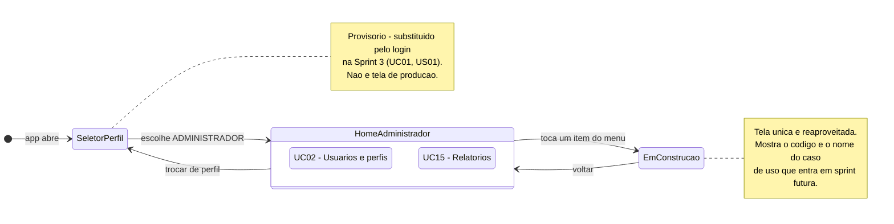

# Diagrama de Navegação — Tela inicial do Administrador

> Especificação da **tela inicial do perfil ADMINISTRADOR** e da navegação que sai dela.
> Entrega da Sprint 2, Pacote 1 — ver [`docs/sprints/sprint-2.md`](../../sprints/sprint-2.md).
>
> **Notação:** máquina de estados UML (`stateDiagram-v2`), em que cada estado é uma tela e cada
> transição é uma ação do usuário. É a notação da tabela de
> [`diagramas/README.md`](../README.md#como-escrever-cada-tipo) que corresponde a navegação.
>
> ⚠️ **Sem back-end.** Nenhuma tela desta sprint chama a API, lê banco ou autentica. Os destinos
> das ações são telas de espera que nomeiam o caso de uso que ainda vai ser implementado.
> Ver [ADR 0004](../../decisoes/0004-regra-de-negocio-na-api.md).



## Legenda

| Elemento | Significa |
|---|---|
| Estado | Uma tela (`Screen`) do app Flutter |
| Transição | Um toque do usuário em um elemento da interface |
| `HomeAdministrador` composto | A tela inicial e o menu que vive dentro dela |
| `EmConstrucao` | Tela de espera compartilhada, parametrizada pelo caso de uso |

## Os elementos da tela inicial

O Administrador tem **dois** casos de uso no documento aprovado — UC02 e UC15
([casos de uso § 3](../../casos-de-uso.md#3-casos-de-uso-identificados)). O menu tem, portanto,
exatamente dois itens. Não inventar um terceiro.

| Ordem | Rótulo | Ícone Material | Caso de uso | Destino |
|---|---|---|---|---|
| 1 | Usuários e perfis | `Icons.manage_accounts_outlined` | [UC02](../../casos-de-uso.md) | `EmConstrucaoScreen(uc: 'UC02', ...)` |
| 2 | Relatórios | `Icons.bar_chart_outlined` | [UC15](../../casos-de-uso.md) | `EmConstrucaoScreen(uc: 'UC15', ...)` |

**Cabeçalho da tela:** `AppBar` com o título `ToolRent` e, abaixo, o nome do perfil
(`Administrador`). Como não há autenticação, **não existe nome de usuário a exibir** — não
colocar um nome fictício que pareça dado real.

**Ação de saída:** um item `Trocar de perfil` que volta ao `SeletorPerfilScreen`. Na Sprint 3 ele
vira `Sair` e encerra a sessão de verdade.

## A casca compartilhada

Este pacote entrega, além da sua tela, os **quatro arquivos que as outras duas telas usam**. Por
isso ele entra primeiro na `main`.

| Arquivo | O que é | Quem usa |
|---|---|---|
| `app/lib/ui/screens/seletor_perfil_screen.dart` | Escolha provisória de perfil, com três opções | ponto de entrada |
| `app/lib/ui/widgets/cartao_acao.dart` | Cartão de ação do menu: ícone, rótulo, destino | as três telas |
| `app/lib/ui/screens/em_construcao_screen.dart` | Tela de espera, recebe código e nome do UC | as três telas |
| `app/lib/main.dart` | `home:` passa a ser o `SeletorPerfilScreen` | — |

### Contrato do `CartaoAcao`

Fixado aqui para que os três possam escrever em paralelo sem descobrir a assinatura por conflito
de merge:

```dart
class CartaoAcao extends StatelessWidget {
  const CartaoAcao({
    super.key,
    required this.rotulo,
    required this.icone,
    required this.aoTocar,
  });

  final String rotulo;
  final IconData icone;
  final VoidCallback aoTocar;
}
```

### Contrato do `EmConstrucaoScreen`

```dart
class EmConstrucaoScreen extends StatelessWidget {
  const EmConstrucaoScreen({
    super.key,
    required this.codigoUc,
    required this.nomeUc,
    required this.sprintPrevista,
  });

  final String codigoUc;      // 'UC02'
  final String nomeUc;        // 'Gerenciar usuários e perfis'
  final String sprintPrevista; // 'Sprint 3'
}
```

## Transições

| De | Para | Gatilho |
|---|---|---|
| *(início)* | `SeletorPerfilScreen` | O app abre |
| `SeletorPerfilScreen` | `HomeAdministradorScreen` | Escolhe Administrador |
| `HomeAdministradorScreen` | `EmConstrucaoScreen` | Toca em um dos dois itens do menu |
| `EmConstrucaoScreen` | `HomeAdministradorScreen` | Botão voltar |
| `HomeAdministradorScreen` | `SeletorPerfilScreen` | Toca em *Trocar de perfil* |

## Fora do escopo, de propósito

- Autenticação e autorização — UC01, Sprint 3. **O seletor de perfil não é controle de acesso**
- Qualquer chamada à API ou ao Supabase
- Qualquer regra de negócio — RN01 a RN12 vivem na API ([ADR 0004](../../decisoes/0004-regra-de-negocio-na-api.md))
- As telas de UC02 e UC15 em si; aqui só a inicial e o caminho até a tela de espera
- Cor literal no widget: tudo sai de `core/app_theme.dart`
