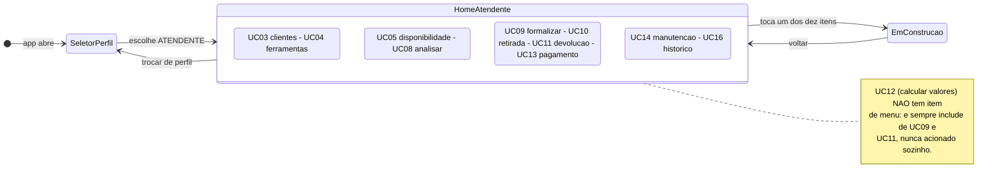

# Diagrama de Navegação — Tela inicial do Atendente

> Especificação da **tela inicial do perfil ATENDENTE** e da navegação que sai dela.
> Entrega da Sprint 2, Pacote 2 — ver [`docs/sprints/sprint-2.md`](../../sprints/sprint-2.md).
>
> **Notação:** máquina de estados UML (`stateDiagram-v2`), em que cada estado é uma tela e cada
> transição é uma ação do usuário.
>
> ⚠️ **Sem back-end.** Nenhuma tela desta sprint chama a API, lê banco ou autentica.
>
> 📦 **Depende do Pacote 1**, que entrega `CartaoAcao`, `EmConstrucaoScreen` e o
> `SeletorPerfilScreen` — ver [`navegacao-administrador.md`](navegacao-administrador.md).

É a maior das três telas: o Atendente concentra **dez** casos de uso. Por isso o menu é agrupado
em quatro seções, e não numa lista corrida de dez itens.

## Legenda

| Elemento | Significa |
|---|---|
| Estado simples | Uma tela (`Screen`) do app Flutter |
| `HomeAtendente` composto | A tela inicial; os estados de dentro são as **seções** do menu dela |
| Estado dentro do composto | Uma seção do menu, com os casos de uso que ela agrupa |
| Transição | Um toque do usuário |

## Os elementos da tela inicial

Dez itens, em quatro seções. A ordem **é** a ordem do fluxo operacional — cadastrar, consultar,
locar, apoiar — e não alfabética.

| Seção | Ordem | Rótulo | Ícone Material | Caso de uso |
|---|---|---|---|---|
| Cadastros | 1 | Clientes | `Icons.people_outline` | [UC03](../../casos-de-uso.md) |
| Cadastros | 2 | Ferramentas e categorias | `Icons.handyman_outlined` | [UC04](../../casos-de-uso.md) |
| Disponibilidade e reservas | 3 | Consultar disponibilidade | `Icons.event_available_outlined` | [UC05](../../casos-de-uso.md) |
| Disponibilidade e reservas | 4 | Analisar reservas | `Icons.fact_check_outlined` | [UC08](../../casos-de-uso.md) |
| Locação | 5 | Formalizar locação | `Icons.assignment_turned_in_outlined` | [UC09](../../casos-de-uso.md) |
| Locação | 6 | Registrar retirada | `Icons.outbox_outlined` | [UC10](../../casos-de-uso.md) |
| Locação | 7 | Registrar devolução | `Icons.assignment_return_outlined` | [UC11](../../casos-de-uso.md) |
| Locação | 8 | Registrar pagamento | `Icons.payments_outlined` | [UC13](../../casos-de-uso.md) |
| Apoio | 9 | Manutenções | `Icons.build_circle_outlined` | [UC14](../../casos-de-uso.md) |
| Apoio | 10 | Histórico do cliente | `Icons.history` | [UC16](../../casos-de-uso.md) |

### Por que dez e não onze

O Atendente aparece em onze linhas da [tabela de casos de uso](../../casos-de-uso.md#3-casos-de-uso-identificados),
mas **UC12 — Calcular valores e encargos não tem item de menu**. Ele é `«include»` de UC09 e de
UC11 ([casos de uso § 3](../../casos-de-uso.md#relações-entre-casos-de-uso)): acontece dentro
desses fluxos, nunca sozinho. Dar a ele um botão na tela inicial seria inventar uma relação que o
diagrama de casos de uso não tem.

**Cabeçalho da tela:** `AppBar` com título `ToolRent` e o nome do perfil (`Atendente`).

**Cada seção** é um rótulo de seção (`Text` com `titleMedium`) seguido dos seus `CartaoAcao`. Em
tela estreita os cartões empilham; em tela larga vão em grade — usar `LayoutBuilder` ou
`Wrap`, sem fixar largura em pixel literal.

## Transições

| De | Para | Gatilho |
|---|---|---|
| `SeletorPerfilScreen` | `HomeAtendenteScreen` | Escolhe Atendente |
| `HomeAtendenteScreen` | `EmConstrucaoScreen` | Toca em qualquer um dos dez itens |
| `EmConstrucaoScreen` | `HomeAtendenteScreen` | Botão voltar |
| `HomeAtendenteScreen` | `SeletorPerfilScreen` | Toca em *Trocar de perfil* |

## Arquivos deste pacote

| Arquivo | O que é |
|---|---|
| `app/lib/ui/screens/home_atendente_screen.dart` | A tela inicial, com as quatro seções |

**Um arquivo só.** Não editar nenhum arquivo dos outros dois pacotes — o `CartaoAcao` e o
`EmConstrucaoScreen` vêm do Pacote 1 e são usados como estão. Se o contrato deles não servir, a
conversa é no PR do Pacote 1, não uma cópia local.

## Fora do escopo, de propósito

- As dez telas de destino — cada uma entra na sua sprint
- UC12 como tela própria; ele é calculado no servidor dentro de UC09 e UC11
- Autenticação, API, banco, regra de negócio
- Cor literal: tudo de `core/app_theme.dart`
