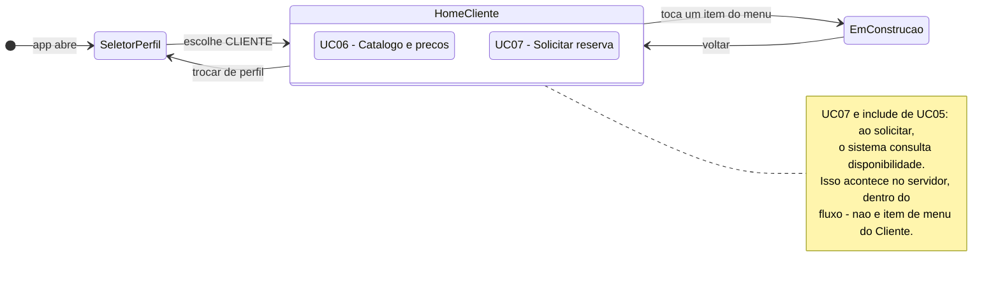

# Diagrama de Navegação — Tela inicial do Cliente

> Especificação da **tela inicial do perfil CLIENTE** e da navegação que sai dela.
> Entrega da Sprint 2, Pacote 3 — ver [`docs/sprints/sprint-2.md`](../../sprints/sprint-2.md).
>
> **Notação:** máquina de estados UML (`stateDiagram-v2`), em que cada estado é uma tela e cada
> transição é uma ação do usuário.
>
> ⚠️ **Sem back-end.** Nenhuma tela desta sprint chama a API, lê banco ou autentica.
>
> 📦 **Depende do Pacote 1**, que entrega `CartaoAcao`, `EmConstrucaoScreen` e o
> `SeletorPerfilScreen` — ver [`navegacao-administrador.md`](navegacao-administrador.md).

## Legenda

| Elemento | Significa |
|---|---|
| Estado simples | Uma tela (`Screen`) do app Flutter |
| `HomeCliente` composto | A tela inicial e os dois itens do menu dela |
| Transição | Um toque do usuário |

## Os elementos da tela inicial

O Cliente tem **dois** casos de uso no documento aprovado — UC06 e UC07
([casos de uso § 3](../../casos-de-uso.md#3-casos-de-uso-identificados)). O menu tem, portanto,
exatamente dois itens.

| Ordem | Rótulo | Ícone Material | Caso de uso | Destino |
|---|---|---|---|---|
| 1 | Catálogo e preços | `Icons.storefront_outlined` | [UC06](../../casos-de-uso.md) | `EmConstrucaoScreen(codigoUc: 'UC06', ...)` |
| 2 | Solicitar reserva | `Icons.add_shopping_cart_outlined` | [UC07](../../casos-de-uso.md) | `EmConstrucaoScreen(codigoUc: 'UC07', ...)` |

**Cabeçalho da tela:** `AppBar` com título `ToolRent` e o nome do perfil (`Cliente`).

### Por que só dois itens

Não é omissão — é o que a documentação aprovada diz. O Cliente *consulta o catálogo e os preços e
solicita reservas*, e nada mais
([casos de uso § 2](../../casos-de-uso.md#2-atores-do-sistema)). Em particular:

| O que **não** entra, e por quê |
|---|
| *"Minhas reservas"* — não existe caso de uso para o Cliente consultar as próprias reservas. UC16, histórico, tem o **Atendente** como ator |
| *"Meus pagamentos"* — UC13 é do Atendente |
| *Consultar disponibilidade* — UC05 é do Atendente. O Cliente alcança a disponibilidade **dentro** de UC07, por `«include»`, não por um item de menu |

Se a equipe quiser uma tela de "minhas reservas", **o caminho é criar o caso de uso primeiro**, no
documento e no diagrama de casos de uso — não adicionar um botão aqui. Ver
[CLAUDE.md regra 2](../../../CLAUDE.md).

## Transições

| De | Para | Gatilho |
|---|---|---|
| `SeletorPerfilScreen` | `HomeClienteScreen` | Escolhe Cliente |
| `HomeClienteScreen` | `EmConstrucaoScreen` | Toca em um dos dois itens |
| `EmConstrucaoScreen` | `HomeClienteScreen` | Botão voltar |
| `HomeClienteScreen` | `SeletorPerfilScreen` | Toca em *Trocar de perfil* |

## Arquivos deste pacote

| Arquivo | O que é |
|---|---|
| `app/lib/ui/screens/home_cliente_screen.dart` | A tela inicial, com os dois itens |
| `app/test/home_cliente_screen_test.dart` | Teste de widget: os dois cartões aparecem e navegam |

**Este é o menor dos três pacotes** — dois itens de menu. Por isso ele também entrega o **teste de
widget de referência**, no modelo que os outros dois passam a seguir nas sprints seguintes. É o
primeiro teste de tela do projeto: hoje o `app/test/` só tem o da tela de boas-vindas.

## Fora do escopo, de propósito

- As telas de UC06 e UC07 em si
- Login do cliente — o vínculo `Cliente ↔ Usuario` está decidido
  ([ADR 0005](../../decisoes/0005-login-proprio-do-cliente.md)), mas autenticar é UC01, Sprint 3
- Autenticação, API, banco, regra de negócio
- Cor literal: tudo de `core/app_theme.dart`
