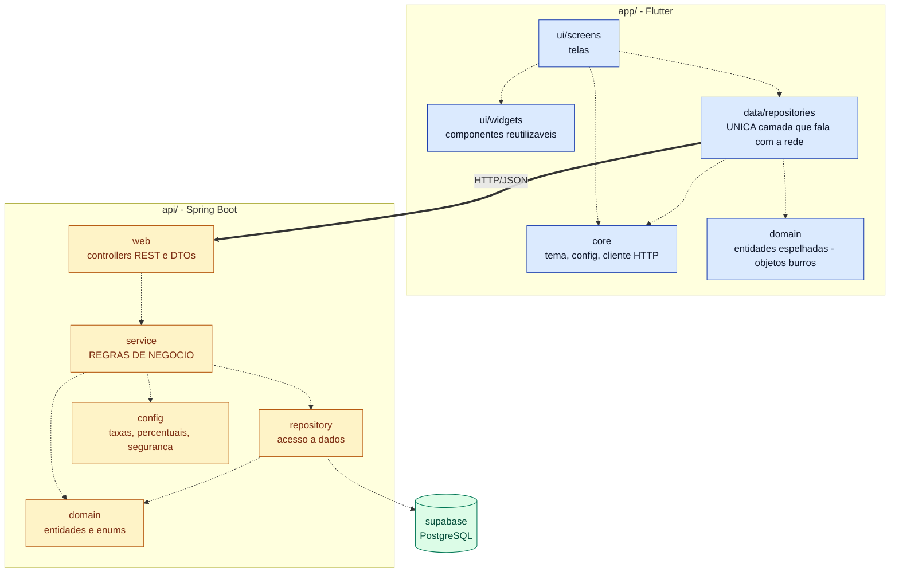

# Diagrama de Pacotes — ToolRent

> **Um dos quatro diagramas UML do capítulo 4** de *Engenharia de Software Moderna*, de Marco
> Tulio Valente — ver [ADR 0015](../../decisoes/0015-diagramas-conforme-engenharia-de-software-moderna.md).
>
> Entrega da Sprint 2, Pacote 1 — ver [`docs/sprints/sprint-2.md`](../../sprints/sprint-2.md).
>
> **Para que serve:** visão de alto nível dos grupos de classes e das dependências entre eles.
> É o diagrama que diz **onde cada coisa mora** e, principalmente, **quem pode depender de quem**.

## Notação

O livro desenha pacote como retângulo com aba e dependência como **seta tracejada**. O Mermaid
não tem diagrama de pacotes nativo, então a convenção aqui — como já se faz no
[diagrama de casos de uso](../sprint-1/casos-de-uso.md) — é `flowchart` com `subgraph` fazendo o
papel do pacote e `-.->` fazendo o papel da dependência.



## Legenda

| Elemento | Significa |
|---|---|
| `subgraph` | Um pacote — grupo de classes com uma responsabilidade |
| Seta tracejada `-.->` | Dependência: o pacote de origem **usa** o de destino |
| Seta cheia `==>` | Fronteira de processo — atravessa a rede, não é chamada de método |
| 🔵 azul | `app/` — Flutter, roda no dispositivo do usuário |
| 🟡 âmbar | `api/` — Spring Boot, roda no servidor |
| 🟢 verde | Persistência |

## A dependência que não existe — e é esse o ponto

A seta cheia entre `data/repositories` e `web` é a **única** ligação entre o app e a API. Tudo
que o app sabe do servidor passa por ali.

Em particular, repare no que **não** está desenhado:

| Dependência ausente | Por quê |
|---|---|
| `ui/screens` → `web` | Widget nunca chama HTTP direto. Sempre via `data/repositories` |
| `app/domain` → qualquer coisa | São objetos burros: estrutura de dados, sem comportamento |
| `service` → `web` | O serviço não conhece HTTP. Não recebe `HttpServletRequest` nem devolve `ResponseEntity` |
| `repository` → `service` | A dependência é de mão única. Persistência não chama regra |
| `web` → `repository` | O controller não pula o serviço para ir direto ao banco |
| `app/*` → regra de negócio | **Não existe pacote de regra no app.** RN01–RN12 vivem em `api/service` ([ADR 0004](../../decisoes/0004-regra-de-negocio-na-api.md)) |

**Seta que aparecer fora deste diagrama é erro de arquitetura, não liberdade de implementação.**

## Divergência encontrada entre o desenho e o disco

Ao conferir a estrutura real contra [`arquitetura.md`](../../arquitetura.md), apareceu uma pasta
a mais no app:

```
app/lib/domain/rules/     ← existe no disco, vazia, e NÃO está na arquitetura
```

`arquitetura.md` prevê `core/`, `domain/`, `data/repositories/`, `ui/screens/` e `ui/widgets/` —
não prevê `domain/rules/`. Uma pasta chamada *rules* dentro do app é um convite para colocar ali
exatamente o que o [ADR 0004](../../decisoes/0004-regra-de-negocio-na-api.md) proíbe.

**Decisão deste diagrama: a pasta sai.** Ela está vazia, nunca foi usada, e não aparece neste
desenho. Remover é tarefa do Pacote 1.

## Correspondência com o disco

| Pacote no diagrama | Caminho real |
|---|---|
| `ui/screens` | `app/lib/ui/screens/` |
| `ui/widgets` | `app/lib/ui/widgets/` |
| `core` | `app/lib/core/` |
| `data/repositories` | `app/lib/data/repositories/` |
| `domain` (app) | `app/lib/domain/` — com `entities/` e `enums/`, **sem** `rules/` |
| `web` | `api/src/main/java/br/edu/toolrent/api/web/` |
| `service` | `api/src/main/java/br/edu/toolrent/api/service/` |
| `repository` | `api/src/main/java/br/edu/toolrent/api/repository/` |
| `domain` (api) | `api/src/main/java/br/edu/toolrent/api/domain/` |
| `config` | `api/src/main/java/br/edu/toolrent/api/config/` |

Os pacotes da API **já existem**, cada um com o seu `package-info.java`. Os do app existem como
pastas vazias, sem documentação. Equilibrar isso é a implementação deste pacote de trabalho.
