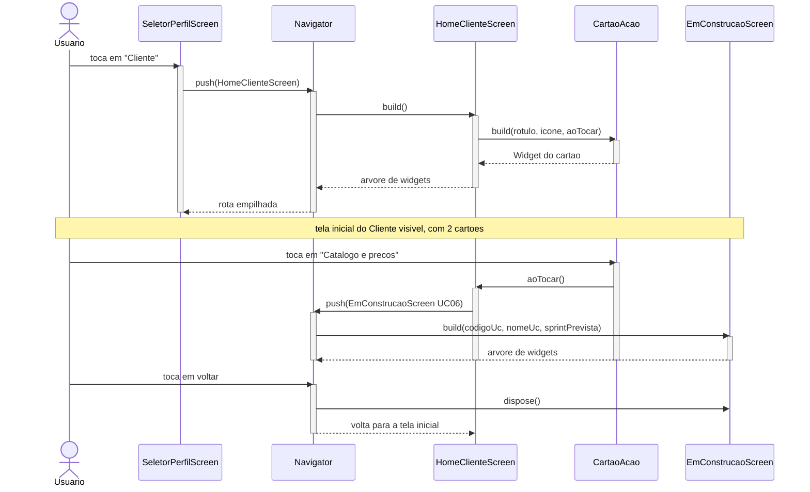

# Diagrama de Sequência — Abrir a tela inicial e acionar um item do menu

> **Um dos quatro diagramas UML do capítulo 4** de *Engenharia de Software Moderna*, de Marco
> Tulio Valente — ver [ADR 0015](../../decisoes/0015-diagramas-conforme-engenharia-de-software-moderna.md).
>
> Entrega da Sprint 2, Pacote 3 — ver [`docs/sprints/sprint-2.md`](../../sprints/sprint-2.md).
>
> **Para que serve:** modelar o comportamento dinâmico de um cenário específico — a sequência de
> chamadas entre os objetos.
>
> ⚠️ **Sem back-end.** Os objetos deste diagrama são todos do app. Nenhuma chamada sai do
> dispositivo.

## Notação

O livro desenha objeto como retângulo no topo, linha de vida vertical (tracejada quando inativo,
sólida quando ativo), seta horizontal nomeada para a chamada e seta tracejada para o retorno. O
Mermaid tem `sequenceDiagram` nativo, com exatamente esses elementos.



## Legenda

| Elemento | Significa |
|---|---|
| Ator | A pessoa usando o app |
| Participante | Um objeto do app — tela ou componente |
| Linha sólida | Objeto ativo, executando |
| Seta cheia | Chamada |
| Seta tracejada | Retorno |

## O cenário escolhido, e por quê

O cenário é o do **Cliente**, mas a sequência é **idêntica** para o Administrador e para o
Atendente — muda só qual `Home*Screen` o `Navigator` empilha e quantos `CartaoAcao` a tela
constrói. Desenhar os três seria repetir o mesmo diagrama três vezes com um nome trocado, o que
o livro desaconselha: diagrama é esboço para comunicar, não inventário.

## O que este diagrama fixa para quem implementa

Os contratos que os três pacotes compartilham saem daqui:

```dart
class CartaoAcao extends StatelessWidget {
  const CartaoAcao({
    super.key,
    required this.rotulo,
    required this.icone,
    required this.aoTocar,
  });

  final String rotulo;
  final IconData icone;
  final VoidCallback aoTocar;
}
```

```dart
class EmConstrucaoScreen extends StatelessWidget {
  const EmConstrucaoScreen({
    super.key,
    required this.codigoUc,      // 'UC06'
    required this.nomeUc,        // 'Consultar catálogo e preços'
    required this.sprintPrevista, // 'Sprint 4'
  });

  final String codigoUc;
  final String nomeUc;
  final String sprintPrevista;
}
```

**É por existir este contrato que os três podem escrever em paralelo.** Sem ele, cada um
descobriria a assinatura do outro por conflito de merge.

## O que o diagrama mostra por ausência

| Não aparece | Por quê |
|---|---|
| Nenhum `Repository` | Nenhuma tela desta sprint busca dado |
| Nenhuma chamada HTTP | Não há API a chamar — a Sprint 2 é só front-end |
| Nenhum objeto de domínio | `Ferramenta`, `Reserva` e companhia são Sprint 3 |
| Nenhuma validação | Regra de negócio é da API ([ADR 0004](../../decisoes/0004-regra-de-negocio-na-api.md)) |

**Se a implementação precisar de um participante que não está aqui, o diagrama muda primeiro**,
em PR próprio ([ADR 0010](../../decisoes/0010-diagrama-antes-da-implementacao.md)).

## O próximo diagrama de sequência

Este cobre um fluxo de interface. Os fluxos de negócio — em que `web`, `service` e `repository`
aparecem como participantes — entram quando houver back-end:

| Diagrama | Caso de uso | Sprint |
|---|---|---|
| `sprint-4/sequencia-uc05.md` | Consultar disponibilidade | 4 |
| `sprint-5/sequencia-uc09.md` | Formalizar locação | 5 |
