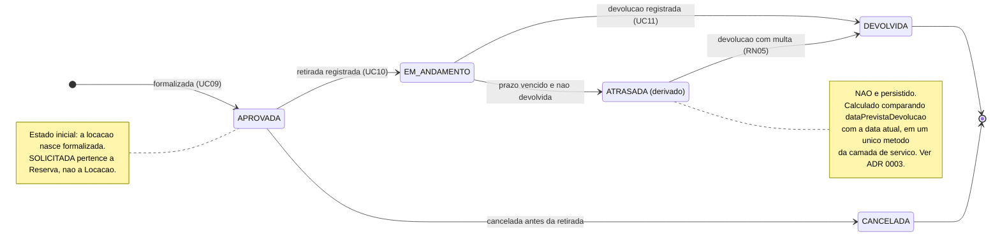

# Diagrama de Estados — Locação

> ℹ️ **Cópia de conveniência — a Sprint 3 implementa este diagrama (TT02).**
> Ele nasceu na Sprint 2; a **fonte editável** é [`../sprint-2/estados-locacao.md`](../sprint-2/estados-locacao.md).
> Mudou o ciclo de vida? Edite a fonte e atualize esta cópia **no mesmo PR**, para nunca divergirem.

> Especificação do ciclo de vida da `Locacao`. Entrega da Sprint 2 —
> ver [`docs/sprints/sprint-2.md`](../../sprints/sprint-2.md).
>
> Esta é a entidade que cumpre a exigência da disciplina de **pelo menos uma entidade com
> ciclo de vida de quatro ou mais estados**.



## Os quatro estados persistidos

`EstadoLocacao` tem **exatamente** quatro valores: `APROVADA`, `EM_ANDAMENTO`, `DEVOLVIDA`,
`CANCELADA`. `ATRASADA` aparece no diagrama porque existe conceitualmente, mas **não é um valor
do enum nem uma coluna do banco**.

| De | Para | Gatilho | Regras |
|---|---|---|---|
| — | `APROVADA` | Locação formalizada | RN01 · RN02 · RN03 · RN04 valor base calculado |
| `APROVADA` | `EM_ANDAMENTO` | Retirada registrada | RN03 ferramenta não pode estar em manutenção · RN08 |
| `APROVADA` | `CANCELADA` | Cancelada antes da retirada | Libera o período |
| `EM_ANDAMENTO` | `DEVOLVIDA` | Devolução registrada | RN04–RN06 valores · RN12 precisão |
| `EM_ANDAMENTO` | *(leitura)* `ATRASADA` | Prazo venceu | Mudança de **leitura**, não transição executada |

## Transições proibidas

- `DEVOLVIDA` → qualquer coisa — locação encerrada não reabre
- `CANCELADA` → qualquer coisa
- `APROVADA` → `DEVOLVIDA` — não se devolve o que não foi retirado
- `EM_ANDAMENTO` → `CANCELADA` — a ferramenta já saiu; o caminho é devolver

## Por que `ATRASADA` é derivado

Um estado persistido exigiria um processo agendado virando registros todo dia. Se o processo
falhasse, o banco passaria a mentir. Derivado, o estado é correto por construção.

```java
if (estadoPersistido == EM_ANDAMENTO && dataPrevistaDevolucao.isBefore(agora)) {
    return ATRASADA;
}
return estadoPersistido;
```

**O cálculo fica em um único método da camada de serviço.** Nenhuma consulta SQL e nenhum trecho
do app Flutter repete essa comparação. Justificativa completa em
[ADR 0003](../../decisoes/0003-estado-atrasada-derivado.md).

## Decisões aplicadas

| Decisão | O que vale | ADR |
|---|---|---|
| **#5** — locação presencial | A locação **pode** nascer sem reserva, no atendimento direto, com as mesmas validações | ✅ [0007](../../decisoes/0007-locacao-presencial-sem-reserva.md) |
| **#6** — devolução parcial | **Não existe.** A transição `EM_ANDAMENTO → DEVOLVIDA` encerra o contrato inteiro | ✅ [0013](../../decisoes/0013-devolucao-sempre-integral.md) |
| **#4** — multa de atraso | `ATRASADA → DEVOLVIDA` aplica 20% da diária por diária de atraso | ✅ [0012](../../decisoes/0012-multa-por-atraso-e-politica-de-danos.md) |

Nenhuma decisão pendente afeta este diagrama.
