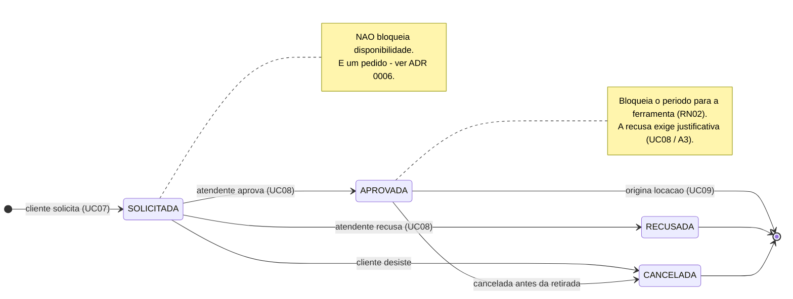

# Diagrama de Estados — Reserva

> ℹ️ **Cópia de conveniência — a Sprint 3 implementa este diagrama (TT02).**
> Ele nasceu na Sprint 2; a **fonte editável** é [`../sprint-2/estados-reserva.md`](../sprint-2/estados-reserva.md).
> Mudou o ciclo de vida? Edite a fonte e atualize esta cópia **no mesmo PR**, para nunca divergirem.

> Especificação do ciclo de vida da `Reserva`. Entrega da Sprint 2 —
> ver [`docs/sprints/sprint-2.md`](../../sprints/sprint-2.md).
>
> **As transições válidas são exatamente estas.** Qualquer outra é rejeitada na camada de
> serviço, não escondida na interface (RN08, RN09).

## Transições

| De | Para | Gatilho | Quem | Regras |
|---|---|---|---|---|
| — | `SOLICITADA` | Cliente solicita reserva | Cliente | RN01 período válido · RN03 ferramenta disponível |
| `SOLICITADA` | `APROVADA` | Atendente aprova | Atendente | RN02 sem conflito no período · RN09 |
| `SOLICITADA` | `RECUSADA` | Atendente recusa | Atendente | Justificativa obrigatória · RN09 |
| `SOLICITADA` | `CANCELADA` | Cliente desiste | Cliente | — |
| `APROVADA` | `CANCELADA` | Cancelamento antes da retirada | Atendente ou Cliente | Libera o período reservado |
| `APROVADA` | *(final)* | Reserva vira locação | Atendente | UC09 · a reserva não volta a estados anteriores |

## Transições proibidas

Estas **não** existem e devem ser rejeitadas com erro claro:

- `RECUSADA` → qualquer coisa — decisão tomada não se desfaz; o cliente abre nova reserva
- `CANCELADA` → qualquer coisa — mesma razão
- `SOLICITADA` → formalizar locação direto, sem passar por `APROVADA`
- `APROVADA` → `RECUSADA` — recusar depois de aprovar é cancelar, não recusar

## Decisão aplicada

✅ **Decisão #2** — [ADR 0006](../../decisoes/0006-reserva-bloqueia-apenas-apos-aprovacao.md),
aceita em 07/11/2026: **só a reserva `APROVADA` bloqueia a disponibilidade.** A `SOLICITADA` é um
pedido, e pedido pode ser recusado.

Isso não muda os estados nem as transições deste diagrama — muda a regra de disponibilidade
(RN02, UC05). A consequência que **precisa** aparecer na interface: duas pessoas podem solicitar o
mesmo período, e a tela de análise tem de mostrar o pedido concorrente, senão o Atendente aprova
os dois e cria o conflito que o sistema existe para evitar.
