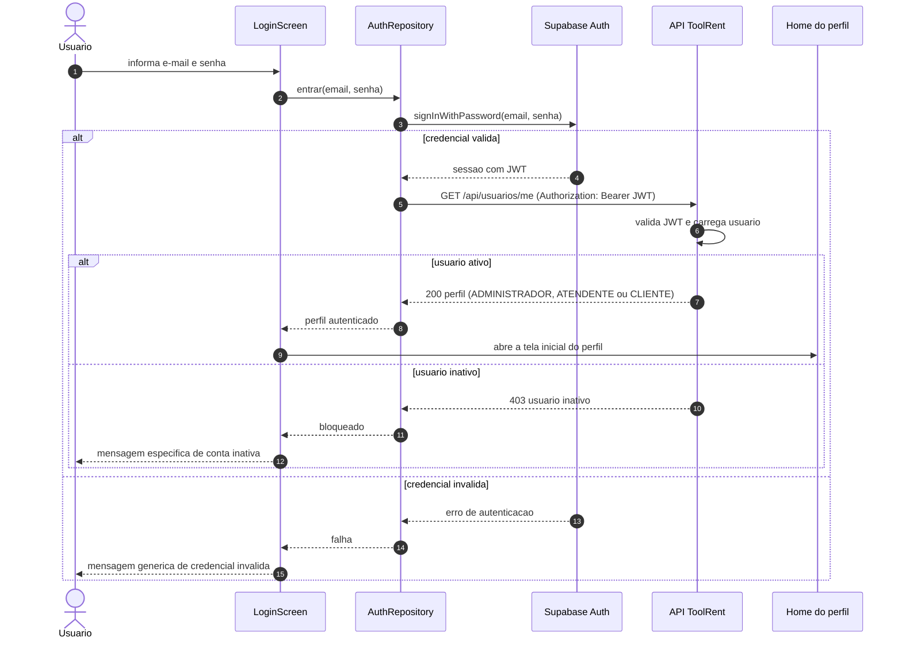
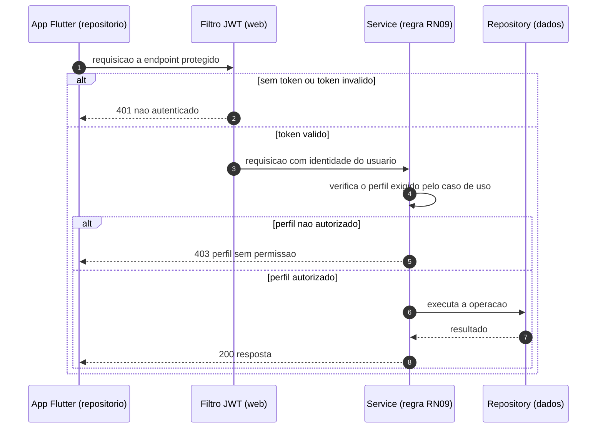

ja # Diagrama de Sequência — Autenticar-se e autorizar por perfil (UC01)

> **Especificação da US01 e do contrato de autorização que a US02 consome.**
> Documento correspondente: [`casos-de-uso.md`](../../casos-de-uso.md) (UC01) ·
> [`backlog.md`](../../backlog.md#us01) · regras RN09 e RN10 ·
> [ADR 0004](../../decisoes/0004-regra-de-negocio-na-api.md) ·
> [ADR 0005](../../decisoes/0005-login-proprio-do-cliente.md)
>
> Nasceu na Sprint 3, para implementação na Sprint 3 — ver [plano](../../sprints/sprint-3.md).

A senha nunca passa pela API do ToolRent nem fica no banco da aplicação (RN10): quem autentica
é o **Supabase Auth**. A API só **valida o JWT** e decide a autorização pelo perfil gravado na
tabela `usuario` (RN09). O app não decide nada — exibe o que a API responder (ADR 0004).

## Parte 1 — Login e abertura da tela do perfil

## Parte 2 — Requisição protegida e autorização por perfil (RN09)

O mesmo contrato vale para **todo** endpoint protegido. A US02 é a primeira a usá-lo: os
endpoints de gerenciar usuários exigem perfil `ADMINISTRADOR`.

## Legenda

| Participante | O que é | Onde mora |
|---|---|---|
| `LoginScreen` | Tela de login — substitui o seletor de perfil provisório da Sprint 2 | `app/lib/ui/screens/` |
| `AuthRepository` | Única porta de saída de rede do fluxo de autenticação | `app/lib/data/repositories/` |
| `Supabase Auth` | Identidade, senha e emissão do JWT — a senha vive só aqui (RN10) | Supabase |
| `API ToolRent` / `Filtro JWT` / `Service` | Validação do token em `web/`, autorização (RN09) em `service/` | `api/src/main/java/br/edu/toolrent/api/` |
| `Home do perfil` | `home_administrador_screen` · `home_atendente_screen` · `home_cliente_screen` | entregues na Sprint 2 |

## Decisões que este diagrama aplica

| Ponto | Decisão |
|---|---|
| Senha nunca na API nem no banco da aplicação; `usuario.auth_user_id` referencia o Supabase Auth | RN10 · [ADR 0004](../../decisoes/0004-regra-de-negocio-na-api.md) |
| Perfil `CLIENTE` entra pelo mesmo login — vínculo `Cliente ↔ Usuario` é opcional | [ADR 0005](../../decisoes/0005-login-proprio-do-cliente.md) |
| Autorização no `service/`, nunca no app nem no filtro — `web/` não contém regra | RN09 · [arquitetura](../../arquitetura.md) |
| Mensagem genérica para credencial inválida; específica para conta inativa | critérios da [US01](../../backlog.md#us01) |
