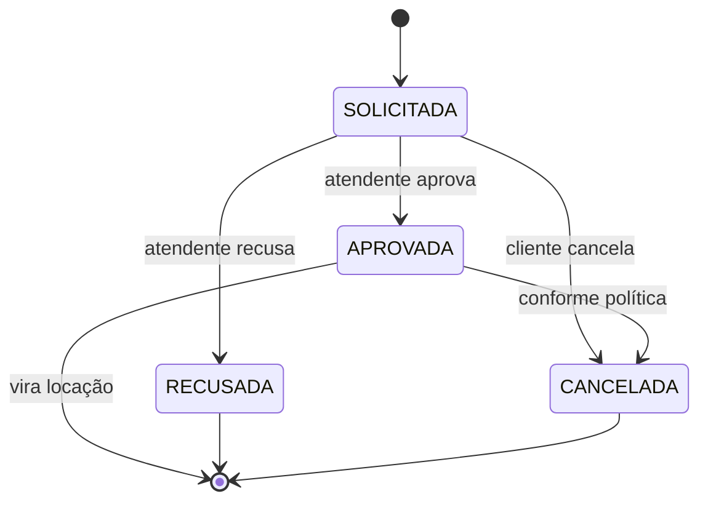
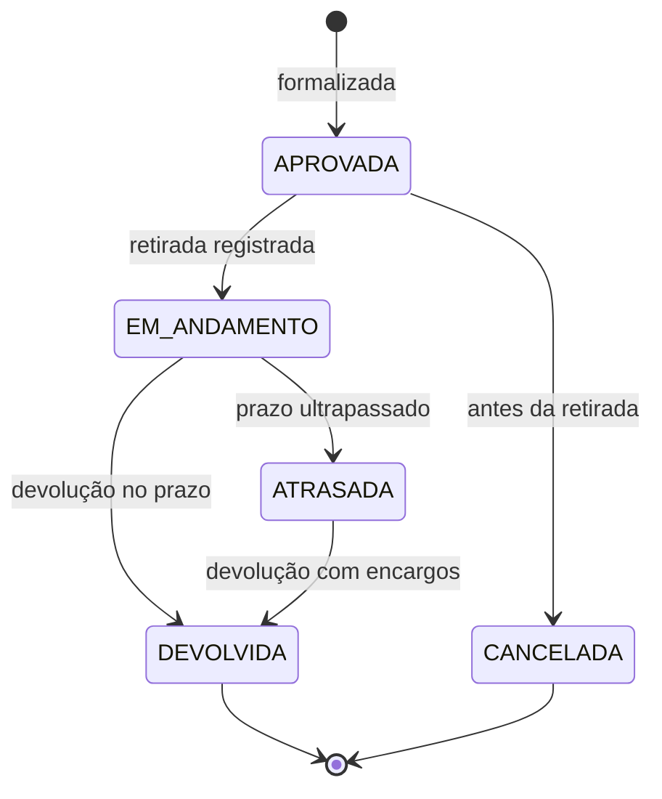

# Regras de Negócio — ToolRent

> **Versão:** 2.0 · 27/10/2026
> Toda regra aqui é implementada na **camada de serviço da API** (`api/src/main/java/br/edu/toolrent/api/service/`). O app Flutter pode repetir uma validação para dar retorno imediato, mas essa repetição é conveniência visual — a API revalida sempre.

---

## Status das regras

| Status | Significado |
|---|---|
| ✅ **Definida** | Regra fechada; pode ser implementada como está |
| ⚠️ **Parâmetro pendente** | A regra existe, mas um valor ou critério ainda depende de decisão da equipe |

---

## Índice

| | | |
|---|---|---|
| [RN01 Período válido](#rn01--período-válido) | [RN05 Atraso](#rn05--atraso) | [RN09 Autorização](#rn09--autorização) |
| [RN02 Disponibilidade](#rn02--disponibilidade-e-conflitos) | [RN06 Danos](#rn06--danos) | [RN10 Senhas](#rn10--senhas) |
| [RN03 Manutenção](#rn03--ferramenta-em-manutenção) | [RN07 Pagamento](#rn07--pagamento) | [RN11 Integridade](#rn11--integridade-referencial) |
| [RN04 Valor-base](#rn04--cálculo-do-valor-base) | [RN08 Transições](#rn08--transições-de-estado) | [RN12 Dinheiro e datas](#rn12--dinheiro-e-datas) |

---

## RN01 — Período válido

✅ **Definida**

A data/hora inicial de uma reserva ou locação deve ser **estritamente anterior** à data/hora final.

Períodos inválidos são rejeitados com mensagem compreensível, indicando qual campo corrigir. A validação ocorre antes de qualquer consulta de disponibilidade.

**Onde se aplica:** UC05, UC07, UC09, UC15
**Verificação:** teste rejeitando início igual ao fim, início posterior ao fim e datas nulas.

---

## RN02 — Disponibilidade e conflitos

⚠️ **Parâmetro pendente** — ver decisão #2

Uma ferramenta não pode ser reservada ou locada para um período que se sobreponha a outra locação ativa ou reserva bloqueante.

**Dois períodos se sobrepõem quando** `inicioA < fimB` **e** `inicioB < fimA`. Períodos que apenas se tocam nas extremidades não conflitam.

```
A: |-------|
B:         |-------|     → não conflita (toca na extremidade)

A: |-------|
B:     |-------|         → CONFLITA (sobreposição parcial)

A: |-----------|
B:    |----|             → CONFLITA (contido)
```

> **Pendência:** uma reserva no estado `SOLICITADA` bloqueia a disponibilidade, ou apenas após virar `APROVADA`?
> **Recomendação da equipe técnica:** bloquear somente a partir de `APROVADA`. Bloquear já na solicitação permite que qualquer cliente trave o catálogo sem compromisso.

**Onde se aplica:** UC05, UC07, UC08, UC09
**Verificação:** testes para sobreposição no início, no fim, contida, idêntica e sem sobreposição.

---

## RN03 — Ferramenta em manutenção

✅ **Definida**

Ferramenta em manutenção, danificada ou marcada como indisponível **não pode** entrar em nova reserva ou locação. Volta a ficar disponível apenas após a conclusão da manutenção com avaliação apta.

**Onde se aplica:** UC05, UC07, UC08, UC09, UC10, UC14
**Verificação:** teste confirmando que ferramenta com manutenção aberta não aparece como disponível.

---

## RN04 — Cálculo do valor-base

⚠️ **Parâmetro pendente** — ver decisão #3

Para cada item da locação, o subtotal é calculado a partir da tarifa registrada, da quantidade e do número de diárias faturáveis.

```
subtotalItem = tarifaDiaria × quantidade × diariasFaturaveis
valorBase    = Σ subtotalItem
```

**A tarifa usada é a que estava vigente no momento da formalização**, gravada no próprio item da locação. Alterações posteriores no catálogo não afetam locações já formalizadas.

> **Pendência:** como contar `diariasFaturaveis`?
> - **Períodos de 24h:** retirada 10h do dia 1, devolução 9h do dia 3 = 1 diária
> - **Diárias iniciadas:** o mesmo caso = 2 diárias
>
> **Recomendação:** diárias iniciadas, com mínimo de 1. É o critério usual do setor e mais simples de explicar ao cliente.

**Onde se aplica:** UC04, UC09, UC11, UC12
**Verificação:** testes com 1 dia, vários dias, múltiplas quantidades e múltiplos itens.

---

## RN05 — Atraso

⚠️ **Parâmetro pendente** — ver decisão #4

A multa por atraso é calculada **apenas** quando a devolução ocorre depois do prazo acordado.

```
diariasAtraso = diárias entre prazo acordado e devolução efetiva
multaAtraso   = diariasAtraso × taxaMultaPorDiaria × quantidade
```

**Restrições obrigatórias:**

- Devolução no prazo ou adiantada **não** gera encargo
- Um mesmo período **nunca** é cobrado duas vezes — o valor-base cobre até o prazo acordado, a multa cobre apenas o excedente
- A taxa de multa é um **parâmetro configurado**, nunca um número literal espalhado pelo código

> **Pendência:** a multa é percentual sobre a diária, valor fixo por diária de atraso, ou combinação?
> **Recomendação:** percentual da tarifa diária por diária de atraso, com o percentual em um único ponto de configuração.

**Onde se aplica:** UC11, UC12
**Verificação:** testes para devolução adiantada, no prazo, 1 dia e vários dias de atraso.

---

## RN06 — Danos

⚠️ **Parâmetro pendente** — ver decisão #4

Danos identificados na devolução são registrados com descrição e valor estimado.

**Uma cobrança por dano só compõe o total devido após aprovação.** Danos registrados mas não aprovados ficam visíveis no histórico sem entrar no valor.

O sistema **não** calcula valor de dano automaticamente — o valor é informado e aprovado por uma pessoa.

> **Pendência:** quem tem alçada para aprovar? Atendente ou apenas Administrador?

**Onde se aplica:** UC11, UC12
**Verificação:** teste confirmando que dano não aprovado não altera o total devido.

---

## RN07 — Pagamento

✅ **Definida**

Todo pagamento registra valor, data, forma e referência à locação.

- Valor menor ou igual a zero é **rejeitado**
- Pagamento parcial é permitido; o saldo permanece em aberto
- Todo pagamento referencia uma locação existente

> **Pendência menor:** política para pagamento acima do saldo — rejeitar, ou aceitar e registrar crédito? **Recomendação:** rejeitar na primeira versão; é o comportamento mais simples de justificar.

**Onde se aplica:** UC13
**Verificação:** testes com valor zero, negativo, parcial, exato e acima do saldo.

---

## RN08 — Transições de estado

✅ **Definida**

Reservas e locações só realizam transições permitidas. Transições ilegais são bloqueadas **na camada de serviço**, nunca apenas desabilitando um botão.

### Estados da Reserva



### Estados da Locação



A entidade `Locacao` possui **5 estados**, cumprindo a exigência de pelo menos uma entidade com ciclo de vida de quatro ou mais estados.

> **Decisão tomada:** `ATRASADA` é um estado **derivado**, calculado em tempo de execução comparando a data prevista de devolução com a data atual. Não é persistido. Isso evita a necessidade de um processo agendado para virar o estado e elimina o risco de o banco ficar desatualizado. Registrado em [`decisoes/0003-estado-atrasada-derivado.md`](decisoes/0003-estado-atrasada-derivado.md).

**Onde se aplica:** UC07, UC08, UC09, UC10, UC11, UC14
**Verificação:** testes confirmando que cada transição ilegal é rejeitada — devolver locação já devolvida, retirar locação cancelada, decidir reserva já processada.

---

## RN09 — Autorização

✅ **Definida**

Ações sensíveis exigem usuário autenticado e perfil autorizado.

**A interface pode ocultar opções não permitidas, mas a validação obrigatória está na API.** Uma requisição sem token válido recebe HTTP 401; com token válido mas perfil insuficiente, HTTP 403.

| Perfil | Pode |
|---|---|
| Administrador | Gerenciar usuários e perfis, consultar relatórios |
| Atendente | Clientes, catálogo, disponibilidade, reservas, locações, pagamentos, manutenção, histórico |
| Cliente | Consultar catálogo, solicitar reservas, ver apenas os próprios dados |

**Onde se aplica:** todos os casos de uso
**Verificação:** para cada endpoint protegido, um teste sem token e um com perfil insuficiente.

---

## RN10 — Senhas

✅ **Definida**

Senha **nunca** é armazenada em texto puro.

A autenticação é delegada ao **Supabase Auth**, que aplica hash com salt e parâmetros adequados. A equipe não implementa algoritmo criptográfico próprio e não armazena senha em tabela da aplicação.

Senhas nunca aparecem em log, mensagem de erro ou tela — nem mesmo para o Administrador.

**Onde se aplica:** UC01, UC02
**Verificação:** inspeção do schema confirmando ausência de coluna de senha nas tabelas da aplicação.

---

## RN11 — Integridade referencial

✅ **Definida**

O banco usa chaves primárias e estrangeiras com integridade garantida pelo PostgreSQL.

**Registros históricos referenciados não são excluídos.** Cliente com locações, ferramenta com histórico e usuário com operações registradas são **inativados**, não removidos.

Operações que alteram várias tabelas rodam em **transação**: ou tudo é gravado, ou nada é.

**Onde se aplica:** UC02, UC03, UC04, UC09, UC11, UC13, UC14
**Verificação:** teste confirmando que falha no meio da formalização de locação não deixa itens órfãos.

---

## RN12 — Dinheiro e datas

✅ **Definida**

**Dinheiro:**

- Na API, valores monetários usam `BigDecimal` — **nunca** `double` ou `float`
- No banco, a coluna é `NUMERIC(12,2)`
- Precisão e modo de arredondamento são definidos em **um único ponto** do código
- Arredondamento: `RoundingMode.HALF_UP`, 2 casas decimais

> `double` não representa `0.1` exatamente. Somar centavos em ponto flutuante produz erro acumulado — inaceitável num sistema que cobra dinheiro.

**Datas:**

- Armazenadas em UTC (`timestamptz`)
- Convertidas explicitamente para o fuso local apenas na apresentação
- Na API, `LocalDate` e `LocalDateTime`; no Dart, `DateTime`

**Onde se aplica:** UC04, UC09, UC11, UC12, UC13, UC15
**Verificação:** teste de soma de valores fracionários confirmando ausência de erro de precisão.

---

## Resumo das pendências

| # | Pendência | Regra | Recomendação |
|---|---|---|---|
| 2 | Reserva `SOLICITADA` bloqueia disponibilidade? | RN02 | Bloquear só a partir de `APROVADA` |
| 3 | Critério de contagem de diárias | RN04 | Diárias iniciadas, mínimo de 1 |
| 4 | Fórmula da multa e alçada de aprovação de danos | RN05, RN06 | Percentual da diária; alçada a definir |
| — | Política para pagamento acima do saldo | RN07 | Rejeitar na primeira versão |

**Nenhuma pendência bloqueia as Sprints 1 a 4.** Todas precisam estar resolvidas antes da Sprint 6 (cálculos e devolução).
