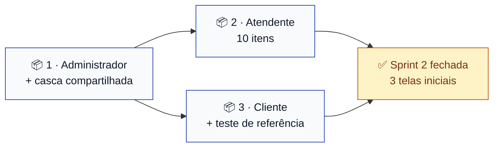

# Sprint 2 — Telas iniciais por perfil

> **Escopo:** três telas iniciais, uma por perfil de usuário. **Só front-end.**
> **Quadro:** [ToolRent — Backlog](https://trello.com/b/m3gakhP8/toolrent-backlog)
> **Situação:** diagramas escritos. A implementação começa quando este PR for mergeado.

---

## Objetivo

Dar ao app a **primeira tela de cada perfil**, com o menu das ações que aquele perfil pode
executar, navegando para telas de espera que nomeiam o caso de uso de cada destino.

Três coisas, três diagramas, três pessoas. Nada além disso.

### Por que front-end primeiro

A Sprint 3 é autenticação, e o critério de entrega dela é *"login funcionando, **com menus
diferentes por perfil**"* ([`sprints.md`](../agil/sprints.md)). Esses menus são exatamente o que
esta sprint constrói. Quando o login entrar, ele passa a decidir **qual** das três telas abre —
as telas já existirão.

### 🚫 Nada de back-end

| Não entra nesta sprint | Onde entra |
|---|---|
| Classes de domínio em Java | Sprint 3, [TT01](https://github.com/kassiods/ToolRent/issues/21) e [TT02](https://github.com/kassiods/ToolRent/issues/22) |
| Endpoint, service, repository | Sprint 3 em diante |
| Banco de dados, migration aplicada | adiado — ver abaixo |
| Autenticação de verdade | Sprint 3, UC01 |
| Qualquer regra de negócio RN01–RN12 | sempre na API ([ADR 0004](../decisoes/0004-regra-de-negocio-na-api.md)) |

Enquanto não há login, um **seletor de perfil provisório** abre o app e deixa escolher qual das
três telas ver. Ele **não é controle de acesso** e sai na Sprint 3.

---

## Os três diagramas — escritos antes do código

Sob o [ADR 0010](../decisoes/0010-diagrama-antes-da-implementacao.md). Cada pacote tem o seu, em
[`docs/diagramas/sprint-2/`](../diagramas/sprint-2/):

| Pacote | Diagrama | Especifica |
|---|---|---|
| 1 | [`navegacao-administrador.md`](../diagramas/sprint-2/navegacao-administrador.md) | Tela do Administrador (UC02, UC15) **+ a casca compartilhada** |
| 2 | [`navegacao-atendente.md`](../diagramas/sprint-2/navegacao-atendente.md) | Tela do Atendente — dez itens em quatro seções |
| 3 | [`navegacao-cliente.md`](../diagramas/sprint-2/navegacao-cliente.md) | Tela do Cliente (UC06, UC07) + o teste de widget de referência |

**Se a implementação precisar divergir do diagrama, o diagrama muda primeiro**, em PR próprio.
Não existe "ajusto no código e atualizo o desenho depois".

---

## Pacotes de trabalho

Cada pacote é uma Issue, um cartão no quadro e uma branch. **Ninguém edita arquivo do outro.**

### 📦 Pacote 1 — Tela inicial do Administrador + casca compartilhada

**Responsável:** Nailan Lucas dos Santos Nobre
**Issue:** [#26](https://github.com/kassiods/ToolRent/issues/26) · **Branch:** `feat/TT05-tela-inicial-administrador`
**Diagrama:** [`navegacao-administrador.md`](../diagramas/sprint-2/navegacao-administrador.md)

| Arquivo | O que é |
|---|---|
| `app/lib/ui/screens/seletor_perfil_screen.dart` | Escolha provisória de perfil — três opções |
| `app/lib/ui/widgets/cartao_acao.dart` | Cartão de ação do menu (ícone, rótulo, callback) |
| `app/lib/ui/screens/em_construcao_screen.dart` | Tela de espera, recebe código e nome do UC |
| `app/lib/ui/screens/home_administrador_screen.dart` | A tela inicial do Administrador |
| `app/lib/main.dart` | `home:` passa a ser o `SeletorPerfilScreen` |

**Pronto quando:**
- As quatro telas/widgets existem com os nomes e as assinaturas **exatas** do diagrama
- O menu do Administrador tem **exatamente dois** itens — UC02 e UC15. Nem mais, nem menos
- `CartaoAcao` e `EmConstrucaoScreen` têm os construtores publicados no diagrama, sem mudança
- Nenhuma cor literal: tudo de `core/app_theme.dart` (convenção do `CLAUDE.md`)
- Nenhuma chamada HTTP, nenhum `Repository`, nenhuma regra de negócio
- Nenhum nome de usuário fictício na tela — não há usuário autenticado ainda
- O teste existente da tela de boas-vindas continua passando, ou é ajustado no mesmo PR se a
  troca do `home:` o afetar
- `flutter analyze` sem nenhum aviso e `flutter test` verde

**Sem dependência. Entra primeiro** — os outros dois pacotes usam a casca que ele entrega.

### 📦 Pacote 2 — Tela inicial do Atendente

**Responsável:** Lincoln Gustavo de Brito Soares
**Issue:** [#27](https://github.com/kassiods/ToolRent/issues/27) · **Branch:** `feat/TT06-tela-inicial-atendente`
**Diagrama:** [`navegacao-atendente.md`](../diagramas/sprint-2/navegacao-atendente.md)

| Arquivo | O que é |
|---|---|
| `app/lib/ui/screens/home_atendente_screen.dart` | A tela inicial, com as quatro seções |

**Pronto quando:**
- Os **dez** itens do diagrama existem, com o rótulo, o ícone e a seção especificados
- **UC12 não tem item de menu.** Ele é `«include»` de UC09 e UC11 — botão próprio seria inventar relação
- As quatro seções aparecem na ordem do fluxo operacional, não em ordem alfabética
- Os cartões se reorganizam em tela estreita e em tela larga, sem largura em pixel literal
- Usa o `CartaoAcao` e o `EmConstrucaoScreen` do Pacote 1 **como estão** — nenhuma cópia local
- Nenhuma cor literal, nenhuma chamada HTTP, nenhuma regra de negócio
- `flutter analyze` sem nenhum aviso e `flutter test` verde

**É a maior das três** — dez itens contra dois. **Depende do Pacote 1.**

### 📦 Pacote 3 — Tela inicial do Cliente

**Responsável:** Victor Rennan Alves Sátiro
**Issue:** [#28](https://github.com/kassiods/ToolRent/issues/28) · **Branch:** `feat/TT07-tela-inicial-cliente`
**Diagrama:** [`navegacao-cliente.md`](../diagramas/sprint-2/navegacao-cliente.md)

| Arquivo | O que é |
|---|---|
| `app/lib/ui/screens/home_cliente_screen.dart` | A tela inicial, com os dois itens |
| `app/test/home_cliente_screen_test.dart` | Teste de widget: os cartões aparecem e navegam |

**Pronto quando:**
- O menu tem **exatamente dois** itens — UC06 e UC07
- **Nenhum item inventado.** Nada de "minhas reservas" ou "meus pagamentos": não existe caso de
  uso do Cliente para isso, e o diagrama explica por quê
- O teste de widget verifica que os dois cartões aparecem e que tocar neles abre a tela de espera
  com o código do UC correto
- Usa o `CartaoAcao` e o `EmConstrucaoScreen` do Pacote 1 como estão
- Nenhuma cor literal, nenhuma chamada HTTP, nenhuma regra de negócio
- `flutter analyze` sem nenhum aviso e `flutter test` verde

**É o menor dos três** — e é a primeira tarefa do Victor no projeto. Por isso ele entrega também
o **teste de widget de referência**, que fica como modelo para as telas das próximas sprints.
**Depende do Pacote 1.**

---

## Quem faz o quê

| Pacote | Tela | Itens de menu | Responsável |
|---|---|---|---|
| 1 | Administrador + casca | 2 + 4 arquivos compartilhados | **Nailan** |
| 2 | Atendente | 10 | **Lincoln** |
| 3 | Cliente + teste de referência | 2 | **Victor** |

Os pacotes **não têm o mesmo tamanho**, e isso está declarado de propósito: o Atendente concentra
dez dos dezesseis casos de uso, então a tela dele é maior por natureza. O Pacote 1 compensa
carregando a casca que os três usam, e o Pacote 3 compensa com o teste de referência. A divisão foi
acordada com a equipe; o que não deve mudar é a **fronteira entre os pacotes**, porque é ela que
evita conflito de merge.

---

## Ordem de integração

Os três podem **escrever** em paralelo desde já — o diagrama fixa os contratos do `CartaoAcao` e
do `EmConstrucaoScreen`. O que precisa de ordem é o **merge**:

1. O Pacote 1 abre o PR primeiro, e os outros dois revisam com prioridade
2. Pacotes 2 e 3 fazem `git rebase origin/main` assim que o 1 entrar
3. Pacotes 2 e 3 **não dependem um do outro** — podem entrar em qualquer ordem
4. Quem terminar antes não força o merge: espera, rebaseia, confirma o build

---

## O que saiu desta sprint

As **classes de domínio em Java** eram o escopo anterior da Sprint 2. Elas foram movidas para a
**Sprint 3**, com os diagramas que já as especificam — que continuam válidos e mergeados:

| Movido | Para | Por quê |
|---|---|---|
| [TT01](https://github.com/kassiods/ToolRent/issues/21) — domínio de cadastros e catálogo | Sprint 3 | A Sprint 3 é autenticação, e precisa de `Usuario` e `PerfilUsuario` de todo jeito |
| [TT02](https://github.com/kassiods/ToolRent/issues/22) — domínio de locação | Sprint 3 | Mesma razão: sem classe de domínio não há o que persistir nem servir |

Os diagramas [`classes.md`](../diagramas/sprint-2/classes.md),
[`estados-reserva.md`](../diagramas/sprint-2/estados-reserva.md) e
[`estados-locacao.md`](../diagramas/sprint-2/estados-locacao.md) **permanecem na pasta
`sprint-2/`**: a pasta registra em que entrega o diagrama nasceu, não em que sprint ele é
implementado — convenção de [`diagramas/README.md`](../diagramas/README.md#organização-uma-pasta-por-sprint).
Nenhum deles foi reescrito.

**Banco de dados:** segue adiado. Não há projeto Supabase do ToolRent, e esta sprint não precisa
de nenhum. A migration `0001_estrutura_inicial.sql` continua rascunho versionado.

---

## Decisões: nenhuma pendente afeta esta sprint

As sete que travavam implementação foram decididas em 07/11/2026. A única aberta é a **#8** — o
modelo de especificação textual que o professor usa em aula —, que não afeta código.

Duas decisões já tomadas aparecem aqui:

| Decisão | Como aparece |
|---|---|
| [ADR 0002](../decisoes/0002-remocao-do-ator-tecnico.md) — sem o ator Técnico | São **três** telas porque são três atores. UC14 está no menu do Atendente |
| [ADR 0005](../decisoes/0005-login-proprio-do-cliente.md) — cliente com login | Justifica a tela do Cliente existir. Autenticar é Sprint 3 |

---

## Definition of Done da Sprint 2

- [ ] Os três diagramas de navegação estão mergeados na `main` e renderizam no GitHub
- [ ] As três telas iniciais existem e correspondem **exatamente** aos diagramas
- [ ] O seletor de perfil provisório abre as três
- [ ] Nenhuma tela chama API, banco ou autenticação
- [ ] Nenhuma cor literal fora de `core/app_theme.dart`
- [ ] Nenhuma regra de negócio no app ([ADR 0004](../decisoes/0004-regra-de-negocio-na-api.md))
- [ ] `flutter analyze` sem avisos e `flutter test` verde na `main`
- [ ] A [matriz de rastreabilidade](../agil/rastreabilidade.md) aponta o diagrama de cada pacote
- [ ] Os três cartões estão em ✅ no quadro e as Issues, fechadas

**Fora do escopo, de propósito:** classes de domínio, banco, repositórios, serviços, endpoints,
autenticação e as telas de destino de cada caso de uso.
