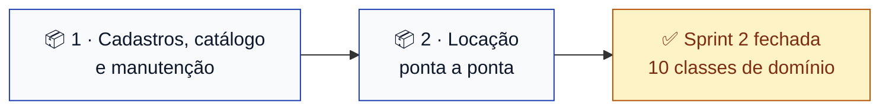

# Sprint 2 — Classes de domínio

> **Situação:** diagramas prontos. Implementação começa quando este PR for mergeado.
> **Quadro:** [ToolRent — Backlog](https://trello.com/b/m3gakhP8/toolrent-backlog)

---

## Objetivo

Transformar o modelo de domínio em **código Java que corresponde exatamente ao diagrama de
classes**.

Nada de regra de negócio nesta sprint: classes de domínio e enumerações. Validação, cálculo e
transição de estado entram da Sprint 3 em diante.

**Sem banco de dados.** O Supabase fica para depois — as classes de domínio são objetos Java
puros, sem anotação de persistência, e nada nesta sprint precisa de um banco no ar. A migration
`0001_estrutura_inicial.sql` continua como rascunho versionado, atualizada para corresponder ao
diagrama.

---

## Os diagramas vêm antes — e já estão escritos

Primeira sprint sob o [ADR 0010](../decisoes/0010-diagrama-antes-da-implementacao.md). Os três
diagramas foram escritos **antes** de qualquer linha de código e vivem em
[`docs/diagramas/sprint-2/`](../diagramas/sprint-2/):

| Diagrama | Especifica | Quem usa |
|---|---|---|
| [`classes.md`](../diagramas/sprint-2/classes.md) | As 10 classes de domínio, atributos, tipos e associações | **Os dois pacotes** |
| [`estados-reserva.md`](../diagramas/sprint-2/estados-reserva.md) | Ciclo de vida da `Reserva` e as transições proibidas | Pacote 2 |
| [`estados-locacao.md`](../diagramas/sprint-2/estados-locacao.md) | Ciclo de vida da `Locacao`, com `ATRASADA` derivado | Pacote 2 |

**Se a implementação precisar divergir do diagrama, o diagrama muda primeiro**, em PR próprio.
Não existe "ajusto no código e atualizo o desenho depois".

---

## Por que o diagrama permite trabalhar em paralelo

Não é burocracia. `Locacao` referencia `Cliente`; `ItemLocacao` referencia `Ferramenta`. Sem um
contrato acordado antes, os dois descobririam as assinaturas um do outro por conflito de merge.

O diagrama de classes **é** esse contrato: cada um sabe o nome exato, o tipo e a multiplicidade do
que o outro vai entregar, e escreve só os seus arquivos.

---

## Pacotes de trabalho

Duas implementações, cinco classes cada. Cada pacote é uma Issue, um cartão no quadro e uma
branch. **Ninguém edita arquivo do outro pacote.**

### 📦 Pacote 1 — Cadastros, catálogo e manutenção

**Issue:** [#21](https://github.com/kassiods/ToolRent/issues/21) · **Branch:** `feat/TT01-dominio-cadastros-e-catalogo`

Tudo que responde *"o que existe e está disponível para locar"*.

| Arquivo em `api/src/main/java/br/edu/toolrent/api/domain/` | Tipo |
|---|---|
| `Usuario.java` | classe |
| `Cliente.java` | classe |
| `Categoria.java` | classe |
| `Ferramenta.java` | classe |
| `Manutencao.java` | classe |
| `PerfilUsuario.java` | enum — ADMINISTRADOR, ATENDENTE, CLIENTE |
| `SituacaoFerramenta.java` | enum — DISPONIVEL, EM_MANUTENCAO, INATIVA |
| `EstadoManutencao.java` | enum — ABERTA, CONCLUIDA |

**Pronto quando:**
- As 5 classes e 3 enums existem, com os atributos e tipos **exatos** do diagrama
- `Ferramenta.tarifaDiaria` é `BigDecimal` — se for `double`, o PR é recusado (RN12)
- `Usuario` **não** tem campo de senha; só `authUserId` (RN10)
- `Cliente` tem o vínculo **opcional** com `Usuario` — o cliente pode ter login, e o cadastro de balcão não exige ([ADR 0005](../decisoes/0005-login-proprio-do-cliente.md))
- Nenhuma classe tem SQL, anotação de persistência ou regra de cálculo
- O Javadoc de `package-info.java` foi atualizado com a lista real de classes
- `./mvnw clean verify` passa

**Sem dependência.** É a base do Pacote 2 — este PR entra primeiro.

### 📦 Pacote 2 — Locação ponta a ponta

**Issue:** [#22](https://github.com/kassiods/ToolRent/issues/22) · **Branch:** `feat/TT02-dominio-locacao`

Tudo que responde *"o contrato, do pedido ao pagamento"*.

| Arquivo em `api/src/main/java/br/edu/toolrent/api/domain/` | Tipo |
|---|---|
| `Reserva.java` | classe |
| `Locacao.java` | classe |
| `ItemLocacao.java` | classe |
| `Devolucao.java` | classe |
| `Pagamento.java` | classe |
| `EstadoReserva.java` | enum — SOLICITADA, APROVADA, RECUSADA, CANCELADA |
| `EstadoLocacao.java` | enum — APROVADA, EM_ANDAMENTO, DEVOLVIDA, CANCELADA |

**Pronto quando:**
- As 5 classes e 2 enums existem, com os atributos e tipos **exatos** do diagrama
- `EstadoLocacao` tem **exatamente quatro** valores. **`ATRASADA` não entra no enum** — é derivado ([ADR 0003](../decisoes/0003-estado-atrasada-derivado.md))
- `EstadoReserva` tem exatamente quatro valores
- `Locacao.reserva` é **opcional** — a locação pode nascer no atendimento direto ([ADR 0007](../decisoes/0007-locacao-presencial-sem-reserva.md))
- `Locacao` tem **no máximo uma** `Devolucao` — devolução é sempre integral ([ADR 0013](../decisoes/0013-devolucao-sempre-integral.md))
- `tarifaRegistrada`, `valorDanos`, `valorMulta` e `valor` são `BigDecimal` (RN12)
- `ItemLocacao.tarifaRegistrada` está documentada como cópia da tarifa no momento da formalização (RN04)
- **Nenhum cálculo é implementado.** As fórmulas estão decididas ([ADR 0011](../decisoes/0011-diaria-iniciada-como-criterio-de-cobranca.md) e [0012](../decisoes/0012-multa-por-atraso-e-politica-de-danos.md)), mas o serviço de cálculo é Sprint 6
- Nenhuma validação de transição — isso é serviço, Sprint 5
- `./mvnw clean verify` passa

**Depende do Pacote 1** (`Cliente`, `Ferramenta`, `Usuario`).

---

## Quem faz o quê

| Pacote | Responsável | Trello |
|---|---|---|
| 1 — Cadastros, catálogo e manutenção | **Nailan Lucas dos Santos Nobre** | `@n2il2nnobre` ✅ no quadro |
| 2 — Locação ponta a ponta | **Lincoln Gustavo de Brito Soares** | `@lincolngustavo` ✅ no quadro |

⚠️ **Falta o Victor Rennan.** Não temos o e-mail dele, então ele ainda não está no quadro. Ele
entra na Sprint 3 ou divide um dos dois pacotes, como a equipe preferir — o Pacote 2 é o mais
divisível (reserva/locação de um lado, devolução/pagamento do outro).

---

## Ordem de integração

Os dois podem **escrever** em paralelo desde já — o diagrama fixa os contratos. O que precisa de
ordem é o **merge**: o Pacote 2 não compila sem as classes do 1.

1. O Pacote 1 abre o PR primeiro, e o outro revisa com prioridade
2. O Pacote 2 faz `git rebase origin/main` assim que o 1 entrar
3. Quem terminar antes **não força o merge** — espera, rebaseia, confirma o build

---

## Decisões: todas tomadas

Esta sprint começa **sem nenhuma decisão pendente que a afete**. As sete que travavam
implementação foram decididas em 07/11/2026:

| Decisão | O que vale | Afeta o quê aqui |
|---|---|---|
| #1 — cliente com login próprio ✅ | Cliente **pode** ter conta; cadastro não exige | `Cliente ↔ Usuario` no Pacote 1 |
| #2 — reserva solicitada não bloqueia ✅ | Só `APROVADA` bloqueia | Nada aqui; é regra de serviço (Sprint 4) |
| #3 — diária iniciada ✅ | Diária começada é cobrada inteira | Nada aqui; é cálculo (Sprint 6) |
| #4 — multa e danos ✅ | 20% da diária por diária de atraso; dano exige aprovação | Os campos de `Devolucao` no Pacote 2 |
| #5 — locação presencial ✅ | Permitida, com as mesmas validações | `Locacao.reserva` opcional, Pacote 2 |
| #6 — sem devolução parcial ✅ | Devolução é do contrato inteiro | `Locacao → 0..1 Devolucao`, Pacote 2 |
| #7 — três relatórios ✅ | Locações, receita, ferramentas mais locadas | Nada aqui; é Sprint 7 |

A única pendência que resta no projeto é a **#8** — o modelo de especificação textual que o
professor usa em aula. Não afeta código.

---

## Definition of Done da Sprint 2

- [ ] Os três diagramas estão mergeados na `main` e renderizam no GitHub
- [ ] As 10 classes de domínio existem e correspondem **exatamente** ao diagrama
- [ ] Nenhuma quantia usa `double` ou `float`
- [ ] `EstadoLocacao` tem quatro valores e **não** inclui `ATRASADA`
- [ ] Nenhuma classe de domínio contém SQL, HTTP ou regra de cálculo
- [ ] `./mvnw clean verify` e `flutter analyze` passam na `main`
- [ ] A [matriz de rastreabilidade](../agil/rastreabilidade.md) aponta o diagrama de cada história
- [ ] Os dois cartões estão em ✅ no quadro e as Issues, fechadas

**Fora do escopo, de propósito:** banco de dados, repositórios JDBC, serviços, endpoints REST,
autenticação e telas. Entram a partir da Sprint 3.
