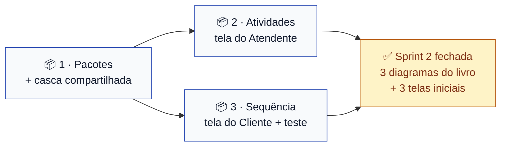

# Sprint 2 — Os três diagramas que faltavam, e as telas que eles especificam

> **Escopo:** os três diagramas do livro que o projeto ainda não tinha, e a implementação de cada
> um. **Só front-end.**
> **Quadro:** [ToolRent — Backlog](https://trello.com/b/m3gakhP8/toolrent-backlog)
> **Situação:** diagramas escritos. A implementação começa quando este PR for mergeado.

---

## Objetivo

Completar o conjunto de diagramas da disciplina e dar ao app a **primeira tela de cada perfil**,
com o menu das ações daquele perfil, navegando para telas de espera que nomeiam o caso de uso de
cada destino.

Três diagramas, três pessoas, três telas.

### Por que front-end primeiro

O critério de entrega da Sprint 3 já era *"login funcionando, **com menus diferentes por
perfil**"* ([`sprints.md`](../agil/sprints.md)). Esses menus são exatamente o que esta sprint
constrói. Quando o login entrar, ele passa a decidir **qual** das três telas abre — as telas já
existirão.

### 🚫 Nada de back-end

| Não entra nesta sprint | Onde entra |
|---|---|
| Classes de domínio em Java | Sprint 3, [TT01](https://github.com/kassiods/ToolRent/issues/21) e [TT02](https://github.com/kassiods/ToolRent/issues/22) |
| Endpoint, service, repository | Sprint 3 em diante |
| Banco de dados, migration aplicada | adiado — ver abaixo |
| Autenticação de verdade | Sprint 3, UC01 |
| Qualquer regra de negócio RN01–RN12 | sempre na API ([ADR 0004](../decisoes/0004-regra-de-negocio-na-api.md)) |

Enquanto não há login, um **seletor de perfil provisório** abre o app e deixa escolher qual das
três telas ver. Ele **não é controle de acesso** e sai na Sprint 3.

---

## Os três diagramas — do livro, e antes do código

A disciplina usa como referência o **[Engenharia de Software Moderna](https://engsoftmoderna.info/)**,
de Marco Tulio Valente. O livro apresenta cinco diagramas; o projeto já tinha dois — casos de uso
e classes. **Os três que faltavam entram nesta sprint, um por integrante**
([ADR 0015](../decisoes/0015-diagramas-conforme-engenharia-de-software-moderna.md)).

| Pacote | Diagrama do livro | Arquivo | Capítulo |
|---|---|---|---|
| 1 | **Pacotes** | [`pacotes.md`](../diagramas/sprint-2/pacotes.md) | 4 |
| 2 | **Atividades** | [`atividades-tela-inicial.md`](../diagramas/sprint-2/atividades-tela-inicial.md) | 4 |
| 3 | **Sequência** | [`sequencia-abrir-tela-inicial.md`](../diagramas/sprint-2/sequencia-abrir-tela-inicial.md) | 4 |

Sob o [ADR 0010](../decisoes/0010-diagrama-antes-da-implementacao.md), os três foram escritos
**antes** de qualquer linha de código. **Se a implementação precisar divergir do diagrama, o
diagrama muda primeiro**, em PR próprio.

---

## Pacotes de trabalho

Cada pacote é **um diagrama do livro + a fatia de código que ele especifica**. Uma Issue, um
cartão no quadro, uma branch. **Ninguém edita arquivo do outro pacote.**

### 📦 Pacote 1 — Diagrama de pacotes + casca compartilhada

**Responsável:** Nailan Lucas dos Santos Nobre
**Issue:** [#26](https://github.com/kassiods/ToolRent/issues/26) · **Branch:** `feat/TT05-pacotes-e-tela-administrador`
**Diagrama:** [`pacotes.md`](../diagramas/sprint-2/pacotes.md) — as camadas de `app/` e `api/`, e quem pode depender de quem

O diagrama de pacotes especifica **estrutura**. A implementação dele é materializar essa
estrutura, mais a casca de UI que as outras duas telas usam.

| Arquivo | O que é |
|---|---|
| `app/lib/ui/widgets/cartao_acao.dart` | Cartão de ação do menu (ícone, rótulo, callback) |
| `app/lib/ui/screens/em_construcao_screen.dart` | Tela de espera, recebe código e nome do UC |
| `app/lib/ui/screens/seletor_perfil_screen.dart` | Escolha provisória de perfil — três opções |
| `app/lib/ui/screens/home_administrador_screen.dart` | Tela inicial do Administrador — 2 itens |
| `app/lib/main.dart` | `home:` passa a ser o `SeletorPerfilScreen` |
| `app/lib/domain/`, `app/lib/data/` | Documentar os pacotes hoje vazios, e **remover `domain/rules/`** |

**Pronto quando:**
- A estrutura de pastas do app corresponde **exatamente** ao diagrama de pacotes
- **`app/lib/domain/rules/` não existe mais.** Pasta chamada *rules* dentro do app contraria o
  [ADR 0004](../decisoes/0004-regra-de-negocio-na-api.md) — e ela está lá hoje, vazia
- `CartaoAcao` e `EmConstrucaoScreen` têm os construtores publicados no diagrama de sequência
- O menu do Administrador tem **exatamente dois** itens — UC02 e UC15
- Nenhuma cor literal: tudo sai de `core/app_theme.dart`
- Nenhuma chamada HTTP, nenhum repository, nenhuma regra de negócio
- Nenhum nome de usuário fictício na tela — não há usuário autenticado ainda
- O teste da tela de boas-vindas continua passando, ou é ajustado neste mesmo PR
- `flutter analyze` sem nenhum aviso e `flutter test` verde

**Sem dependência. Entra primeiro** — os outros dois usam a casca que ele entrega.

### 📦 Pacote 2 — Diagrama de atividades + tela do Atendente

**Responsável:** Lincoln Gustavo de Brito Soares
**Issue:** [#27](https://github.com/kassiods/ToolRent/issues/27) · **Branch:** `feat/TT06-atividades-e-tela-atendente`
**Diagrama:** [`atividades-tela-inicial.md`](../diagramas/sprint-2/atividades-tela-inicial.md) — o fluxo da abertura do app até cada tela inicial

O diagrama de atividades cobre a navegação das **três** telas e traz a tabela de itens de menu de
cada uma. A implementação deste pacote é a maior delas.

| Arquivo | O que é |
|---|---|
| `app/lib/ui/screens/home_atendente_screen.dart` | A tela inicial, com as quatro seções |

**Pronto quando:**
- Os **dez** itens do diagrama existem, com o rótulo, o ícone e a seção especificados
- **UC12 não tem item de menu** — é `«include»` de UC09 e UC11, nunca acionado sozinho
- As quatro seções aparecem na ordem do fluxo operacional, não em ordem alfabética
- Os cartões se reorganizam em tela estreita e em tela larga, sem largura em pixel literal
- Usa o `CartaoAcao` e o `EmConstrucaoScreen` do Pacote 1 **como estão** — nenhuma cópia local
- Nenhuma cor literal, nenhuma chamada HTTP, nenhuma regra de negócio
- `flutter analyze` sem nenhum aviso e `flutter test` verde

**É a maior das três telas** — dez itens contra dois. **Depende do Pacote 1.**

### 📦 Pacote 3 — Diagrama de sequência + tela do Cliente + teste de referência

**Responsável:** Victor Rennan Alves Sátiro
**Issue:** [#28](https://github.com/kassiods/ToolRent/issues/28) · **Branch:** `feat/TT07-sequencia-e-tela-cliente`
**Diagrama:** [`sequencia-abrir-tela-inicial.md`](../diagramas/sprint-2/sequencia-abrir-tela-inicial.md) — a interação entre os objetos ao abrir a tela e tocar num item

O diagrama de sequência é o que **fixa os contratos** do `CartaoAcao` e do `EmConstrucaoScreen`.
Por isso este pacote entrega também o teste que prova que a sequência acontece.

| Arquivo | O que é |
|---|---|
| `app/lib/ui/screens/home_cliente_screen.dart` | A tela inicial, com os dois itens |
| `app/test/home_cliente_screen_test.dart` | Teste de widget: os cartões aparecem e navegam |

**Pronto quando:**
- O menu tem **exatamente dois** itens — UC06 e UC07
- **Nenhum item inventado.** Nada de "minhas reservas" ou "meus pagamentos": não existe caso de
  uso do Cliente para isso, e o diagrama de atividades explica por quê
- O teste percorre a sequência do diagrama: tocar no cartão abre a tela de espera com o
  `codigoUc` correto
- Usa o `CartaoAcao` e o `EmConstrucaoScreen` do Pacote 1 como estão
- Nenhuma cor literal, nenhuma chamada HTTP, nenhuma regra de negócio
- `flutter analyze` sem nenhum aviso e `flutter test` verde

**É a menor das três telas** — e é a primeira tarefa do Victor no projeto. O teste de widget fica
como modelo para as telas das próximas sprints: hoje o `app/test/` só tem o da tela de
boas-vindas. **Depende do Pacote 1.**

---

## Quem faz o quê

| Pacote | Diagrama do livro | Tela que implementa | Itens de menu | Responsável |
|---|---|---|---|---|
| 1 | Pacotes | Administrador + casca | 2 | **Nailan** |
| 2 | Atividades | Atendente | 10 | **Lincoln** |
| 3 | Sequência | Cliente + teste | 2 | **Victor** |

Os pacotes **não têm o mesmo tamanho**, e isso está declarado de propósito: o Atendente concentra
dez dos dezesseis casos de uso, então a tela dele é maior por natureza. O Pacote 1 compensa
carregando a casca que os três usam, e o Pacote 3 compensa com o teste de referência. A divisão
foi acordada com a equipe; o que não deve mudar é a **fronteira entre os pacotes**, porque é ela
que evita conflito de merge.

---

## Ordem de integração

Os três podem **escrever** em paralelo desde já — o diagrama de sequência publica os contratos do
`CartaoAcao` e do `EmConstrucaoScreen`. O que precisa de ordem é o **merge**:

1. O Pacote 1 abre o PR primeiro, e os outros dois revisam com prioridade
2. Pacotes 2 e 3 fazem `git rebase origin/main` assim que o 1 entrar
3. Pacotes 2 e 3 **não dependem um do outro** — podem entrar em qualquer ordem
4. Quem terminar antes **não força o merge**: espera, rebaseia, confirma o build

---

## O que saiu desta sprint

### As classes de domínio

Eram o escopo original da Sprint 2. Foram movidas para a **Sprint 3**, com os diagramas que já as
especificam — que continuam válidos e mergeados:

| Movido | Para | Por quê |
|---|---|---|
| [TT01](https://github.com/kassiods/ToolRent/issues/21) — domínio de cadastros e catálogo | Sprint 3 | A Sprint 3 é autenticação, e precisa de `Usuario` e `PerfilUsuario` de todo jeito |
| [TT02](https://github.com/kassiods/ToolRent/issues/22) — domínio de locação | Sprint 3 | Mesma razão: sem classe de domínio não há o que persistir nem servir |

Os diagramas [`classes.md`](../diagramas/sprint-2/classes.md),
[`estados-reserva.md`](../diagramas/sprint-2/estados-reserva.md) e
[`estados-locacao.md`](../diagramas/sprint-2/estados-locacao.md) **permanecem na pasta
`sprint-2/`**: a pasta registra em que entrega o diagrama nasceu, não em que sprint ele é
implementado — convenção de [`diagramas/README.md`](../diagramas/README.md#organização-uma-pasta-por-sprint).

### Os três diagramas de navegação

Criados mais cedo nesta mesma data e **removidos**: eram máquinas de estado adaptadas para
descrever telas, e não correspondem a nenhum dos cinco diagramas do livro. O conteúdo útil deles
— itens de menu, ícones, rastreabilidade a cada caso de uso — foi preservado dentro do diagrama
de atividades. Ver [ADR 0015](../decisoes/0015-diagramas-conforme-engenharia-de-software-moderna.md).

### O banco

Segue adiado. Não há projeto Supabase do ToolRent, e esta sprint não precisa de nenhum. A
migration `0001_estrutura_inicial.sql` continua rascunho versionado.

---

## Decisões: nenhuma pendente

As oito foram resolvidas em 07/11/2026 — sete pela equipe e a **#8 pelo professor**, que indicou
o *Engenharia de Software Moderna* como referência da disciplina. É daí que sai o conjunto de
diagramas desta sprint.

Três decisões já tomadas aparecem aqui:

| Decisão | Como aparece |
|---|---|
| [ADR 0002](../decisoes/0002-remocao-do-ator-tecnico.md) — sem o ator Técnico | São **três** telas porque são três atores. UC14 está no menu do Atendente |
| [ADR 0005](../decisoes/0005-login-proprio-do-cliente.md) — cliente com login | Justifica a tela do Cliente existir. Autenticar é Sprint 3 |
| [ADR 0015](../decisoes/0015-diagramas-conforme-engenharia-de-software-moderna.md) — diagramas do livro | Define **quais** três diagramas esta sprint entrega |

---

## Definition of Done da Sprint 2

- [ ] Os três diagramas estão mergeados na `main` e renderizam no GitHub
- [ ] O projeto tem os **cinco** diagramas do livro: casos de uso, classes, pacotes, sequência e atividades
- [ ] As três telas iniciais existem e correspondem **exatamente** aos diagramas
- [ ] O seletor de perfil provisório abre as três
- [ ] `app/lib/domain/rules/` foi removido
- [ ] Nenhuma tela chama API, banco ou autenticação
- [ ] Nenhuma cor literal fora de `core/app_theme.dart`
- [ ] Nenhuma regra de negócio no app ([ADR 0004](../decisoes/0004-regra-de-negocio-na-api.md))
- [ ] `flutter analyze` sem avisos e `flutter test` verde na `main`
- [ ] A [matriz de rastreabilidade](../agil/rastreabilidade.md) aponta o diagrama de cada pacote
- [ ] Os três cartões estão em ✅ no quadro e as Issues, fechadas

**Fora do escopo, de propósito:** classes de domínio, banco, repositórios, serviços, endpoints,
autenticação e as telas de destino de cada caso de uso.
