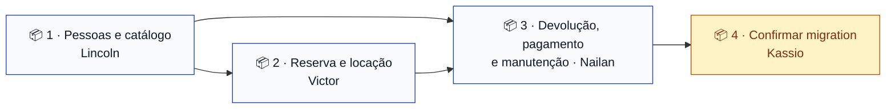

# Sprint 2 — Classes de domínio e banco

> **Situação:** diagramas prontos e em revisão. Implementação começa quando este PR for mergeado.
> **Quadro:** [ToolRent — Backlog](https://trello.com/b/m3gakhP8/toolrent-backlog)

---

## Objetivo

Transformar o modelo de domínio em **código Java que corresponde exatamente ao diagrama de
classes**, e confirmar que a migration do Supabase — hoje em rascunho — corresponde ao mesmo
diagrama.

Nada de regra de negócio nesta sprint. Classes de domínio, enums e a conferência do schema.
Validação, cálculo e transição de estado são Sprint 3 em diante.

---

## Os diagramas vêm antes — e já estão escritos

Esta sprint é a primeira sob a regra do [ADR 0010](../decisoes/0010-diagrama-antes-da-implementacao.md).
Os três diagramas foram escritos **antes** de qualquer linha de código:

| Diagrama | Especifica | Quem usa |
|---|---|---|
| [`classes.md`](../diagramas/classes.md) | As 10 classes de domínio, atributos, tipos e associações | **Os três pacotes** |
| [`estados-reserva.md`](../diagramas/estados-reserva.md) | Ciclo de vida da `Reserva` e transições proibidas | Pacote 2 |
| [`estados-locacao.md`](../diagramas/estados-locacao.md) | Ciclo de vida da `Locacao`, com `ATRASADA` derivado | Pacote 2 |

**Se a implementação precisar divergir do diagrama, o diagrama muda primeiro**, em PR próprio.
Não existe "ajusto no código e depois atualizo o desenho".

---

## Por que o diagrama permite os três trabalharem em paralelo

Não é burocracia. `Locacao` referencia `Cliente`; `ItemLocacao` referencia `Ferramenta`. Sem um
contrato acordado antes, os três descobririam as assinaturas um do outro por conflito de merge.

O diagrama de classes **é** esse contrato: cada um sabe o nome exato, o tipo e a multiplicidade do
que o outro vai entregar, e escreve só os seus arquivos.

---

## Pacotes de trabalho

Cada pacote é uma Issue, um cartão no quadro e uma branch. **Ninguém edita arquivo de outro pacote.**

> A distribuição abaixo é uma proposta de divisão equilibrada — 4, 3 e 3 classes. A equipe pode
> trocar quem pega o quê; o que não deve mudar é a fronteira entre os pacotes.

### 📦 Pacote 1 — Pessoas e catálogo · Lincoln

**Issue:** [#21](https://github.com/kassiods/ToolRent/issues/21) · **Branch:** `feat/TT01-dominio-pessoas-e-catalogo`

| Classe | Arquivo |
|---|---|
| `Usuario` | `api/src/main/java/br/edu/toolrent/api/domain/Usuario.java` |
| `Cliente` | `.../domain/Cliente.java` |
| `Categoria` | `.../domain/Categoria.java` |
| `Ferramenta` | `.../domain/Ferramenta.java` |
| `PerfilUsuario` (enum) | `.../domain/PerfilUsuario.java` |
| `SituacaoFerramenta` (enum) | `.../domain/SituacaoFerramenta.java` |

**Pronto quando:**
- As 4 classes e 2 enums existem, com os atributos e tipos **exatos** do diagrama
- `tarifaDiaria` é `BigDecimal` — se for `double`, o PR é recusado (RN12)
- `Usuario` **não** tem campo de senha (RN10)
- Nenhuma classe tem SQL, anotação de persistência ou regra de cálculo
- O Javadoc de `package-info.java` foi atualizado com a lista real de classes
- `./mvnw clean verify` passa

**Sem dependência de outro pacote.** É a base dos outros dois.

### 📦 Pacote 2 — Reserva e locação · Victor

**Issue:** [#22](https://github.com/kassiods/ToolRent/issues/22) · **Branch:** `feat/TT02-dominio-reserva-e-locacao`

| Classe | Arquivo |
|---|---|
| `Reserva` | `.../domain/Reserva.java` |
| `Locacao` | `.../domain/Locacao.java` |
| `ItemLocacao` | `.../domain/ItemLocacao.java` |
| `EstadoReserva` (enum) | `.../domain/EstadoReserva.java` |
| `EstadoLocacao` (enum) | `.../domain/EstadoLocacao.java` |

**Pronto quando:**
- As 3 classes e 2 enums existem conforme o diagrama
- `EstadoLocacao` tem **exatamente quatro** valores. **`ATRASADA` não entra no enum** — é derivado ([ADR 0003](../decisoes/0003-estado-atrasada-derivado.md))
- `EstadoReserva` tem exatamente quatro valores
- `ItemLocacao.tarifaRegistrada` é `BigDecimal` e está documentado como cópia da tarifa (RN04)
- Os valores dos enums batem com os tipos `estado_reserva` e `estado_locacao` da migration
- Nenhuma validação de transição aqui — isso é serviço, Sprint 5
- `./mvnw clean verify` passa

**Depende do Pacote 1** (`Cliente`, `Ferramenta`, `Usuario`).

### 📦 Pacote 3 — Devolução, pagamento e manutenção · Nailan

**Issue:** [#23](https://github.com/kassiods/ToolRent/issues/23) · **Branch:** `feat/TT03-dominio-devolucao-pagamento-manutencao`

| Classe | Arquivo |
|---|---|
| `Devolucao` | `.../domain/Devolucao.java` |
| `Pagamento` | `.../domain/Pagamento.java` |
| `Manutencao` | `.../domain/Manutencao.java` |
| `EstadoManutencao` (enum) | `.../domain/EstadoManutencao.java` |

**Pronto quando:**
- As 3 classes e o enum existem conforme o diagrama
- `valorDanos`, `valorMulta` e `valor` são `BigDecimal` (RN12)
- **Nenhum cálculo de multa ou dano é implementado.** Os campos existem; a fórmula depende das decisões #3 e #4 e é Sprint 6
- `danosAprovados` existe como `boolean` — a política de aprovação é decisão #4, ainda aberta
- `./mvnw clean verify` passa

**Depende dos Pacotes 1 e 2** (`Usuario`, `Ferramenta`, `Locacao`).

### 📦 Confirmação da migration · Kassio

**Issue:** [#24](https://github.com/kassiods/ToolRent/issues/24) · **Branch:** `chore/TT04-confirma-migration-contra-o-diagrama`

A migration `0001_estrutura_inicial.sql` está em **rascunho** e nunca foi aplicada — não existe
projeto Supabase. Esta tarefa confere tabela por tabela contra o diagrama aprovado e corrige as
divergências **na própria 0001**, que ainda pode ser editada porque nunca foi aplicada.

Entra depois dos três pacotes, para conferir contra o código real.

---

## Ordem de integração

Os três podem **escrever** em paralelo desde já — o diagrama fixa os contratos. O que precisa de
ordem é o **merge**: o Pacote 2 não compila sem as classes do 1. Na prática:

1. Lincoln abre o PR do Pacote 1 primeiro e os outros revisam com prioridade
2. Victor e Nailan fazem `git rebase origin/main` assim que o 1 entrar
3. Quem terminar antes da sua dependência **não força o merge** — espera, rebaseia, confirma o build

---

## O que depende de decisão da equipe

| Pendência | Afeta nesta sprint | Bloqueia? |
|---|---|---|
| **#1** — cliente com login próprio ([ADR 0005](../decisoes/0005-login-proprio-do-cliente.md) 🟡) | A associação `Cliente ↔ Usuario`, que **não** está no diagrama | ❌ Não. As classes existem nos dois cenários; se #1 for aceita, a associação entra depois |
| **#5** — locação presencial sem reserva ([ADR 0007](../decisoes/0007-locacao-presencial-sem-reserva.md) 🟡) | A multiplicidade `Reserva "0..1" → Locacao` | ❌ Não. Muda a multiplicidade, não a existência da classe |
| **#3 e #4** — critério de diária e fórmula de atraso | Os **valores**; não os atributos | ❌ Não, porque nenhum cálculo é implementado nesta sprint |
| **#9 do guia mestre** — campos cadastrais de cliente | Os atributos de `Cliente` | ⚠️ Em aberto. O diagrama usa os campos do rascunho da migration; a equipe confirma ao revisar |

> **Achado desta rodada:** o rascunho da migration já trazia `locacao.reserva_id` anulável com o
> comentário *"nulo em atendimento direto"* — ou seja, **já assumia a decisão #5 como aprovada**,
> sem que ela estivesse. O diagrama manteve a forma, mas agora com a dependência declarada.

---

## Definition of Done da Sprint 2

- [ ] Os três diagramas estão mergeados na `main` e renderizam no GitHub
- [ ] As 10 classes de domínio existem e correspondem **exatamente** ao diagrama de classes
- [ ] Nenhuma quantia usa `double` ou `float`
- [ ] `EstadoLocacao` tem quatro valores e **não** inclui `ATRASADA`
- [ ] Nenhuma classe de domínio contém SQL, HTTP ou regra de cálculo
- [ ] A migration 0001 foi conferida contra o diagrama e as divergências, corrigidas
- [ ] `./mvnw clean verify` e `flutter analyze` passam na `main`
- [ ] A [matriz de rastreabilidade](../agil/rastreabilidade.md) aponta os diagramas de cada história
- [ ] Os quatro cartões estão em ✅ no quadro e as Issues, fechadas

**Fora do escopo desta sprint, de propósito:** repositórios JDBC, serviços, endpoints REST,
autenticação, telas. Entram a partir da Sprint 3.
