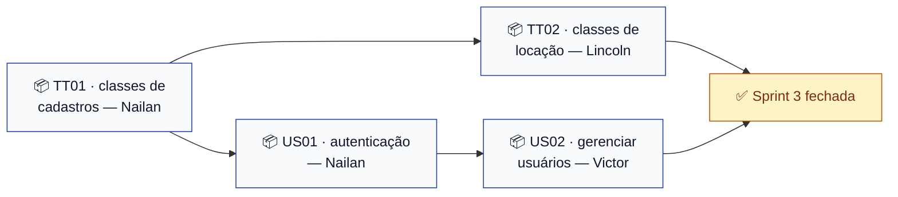

# Sprint 3 — Domínio e autenticação

> **Escopo:** as 10 classes de domínio (TT01, TT02) e a autenticação com perfis (US01, US02). · 10 pontos
> **Quadro:** [ToolRent — Backlog](https://trello.com/b/m3gakhP8/toolrent-backlog)
> **Situação:** em andamento desde 13/11/2026. Infraestrutura pronta: projeto Supabase criado e
> schema aplicado (ver [infraestrutura](#infraestrutura-já-pronta)).

---

## Objetivo

Dar ao sistema a noção de **quem é o usuário**. A entrega demonstrável é: **login funcionando,
decidindo qual das três telas da Sprint 2 abre, e endpoint protegido retornando 403**
([plano geral](../agil/sprints.md#sprint-3--domínio-e-autenticação--10-pontos)).

O seletor de perfil provisório da Sprint 2 **sai** nesta sprint — é o login que passa a decidir.

### Por que as classes entram aqui

Autenticar exige `Usuario` e `PerfilUsuario`. Sem classe de domínio não há o que servir nem
persistir. E a RN09 (autorização no servidor) atravessa todos os casos de uso — por isso a
autenticação vem antes de todo o resto.

---

## Pacotes de trabalho

Uma Issue, um cartão, uma branch por pacote. **Ninguém edita arquivo do outro pacote.**
Todos os diagramas que especificam esta sprint **já estão mergeados** — o portão do
[ADR 0010](../decisoes/0010-diagrama-antes-da-implementacao.md) está cumprido; nenhum pacote
passa pela lista 📐.

### 📦 TT01 — Classes de cadastros, catálogo e manutenção

**Responsável:** Nailan · **Issue:** [#21](https://github.com/kassiods/ToolRent/issues/21) · **Branch:** `feat/TT01-dominio-cadastros-e-catalogo`
**Diagrama:** [`classes.md`](../diagramas/sprint-2/classes.md)

5 classes + 3 enums em `api/src/main/java/br/edu/toolrent/api/domain/`: `Usuario`, `Cliente`,
`Categoria`, `Ferramenta`, `Manutencao`, `PerfilUsuario`, `SituacaoFerramenta`, `EstadoManutencao`.
Critérios de pronto completos no cartão e na Issue. Pontos críticos: `tarifaDiaria` é
`BigDecimal` (RN12) · `Usuario` **não tem senha**, só `authUserId` (RN10) · vínculo
`Cliente ↔ Usuario` opcional (ADR 0005) · nenhuma classe com SQL, persistência ou cálculo.

**Sem dependência — este PR entra primeiro.**

### 📦 TT02 — Classes de locação ponta a ponta

**Responsável:** Lincoln · **Issue:** [#22](https://github.com/kassiods/ToolRent/issues/22) · **Branch:** `feat/TT02-dominio-locacao`
**Diagramas:** [`classes.md`](../diagramas/sprint-2/classes.md) · [`estados-reserva.md`](../diagramas/sprint-2/estados-reserva.md) · [`estados-locacao.md`](../diagramas/sprint-2/estados-locacao.md)

5 classes + 2 enums: `Reserva`, `Locacao`, `ItemLocacao`, `Devolucao`, `Pagamento`,
`EstadoReserva`, `EstadoLocacao`. Pontos críticos: **`ATRASADA` não entra no enum** — é derivado
(ADR 0003) · `Locacao.reserva` opcional (ADR 0007) · no máximo **uma** `Devolucao` por locação
(ADR 0013) · **nenhum cálculo** — as fórmulas (ADRs 0011, 0012) são serviço da Sprint 6 ·
nenhuma validação de transição — é serviço da Sprint 5.

**Depende do TT01.** Pode escrever em paralelo — o diagrama fixa os contratos — e rebaseia
quando o TT01 entrar.

### 📦 US01 — Autenticar-se no sistema · 5 pontos

**Responsável:** Nailan (depois do TT01) · **Issue:** [#1](https://github.com/kassiods/ToolRent/issues/1) · **Branch:** `feat/US01-autenticar-usuario`
**Diagrama:** [`sequencia-uc01.md`](../diagramas/sprint-3/sequencia-uc01.md) — o fluxo do login e o contrato 401/403

Supabase Auth emite o JWT; a API valida; o app só exibe. Tarefas do backlog: configurar o
Supabase Auth · tela de login no Flutter · validação de JWT na API · filtro de autorização por
perfil. Critérios de aceite na [US01 do backlog](../backlog.md#us01) — destaque: mensagem
genérica para credencial inválida, HTTP 401 sem token, menu conforme o perfil.

O login passa a decidir qual tela inicial abre — e o `seletor_perfil_screen.dart` é removido
**neste pacote**, com os testes ajustados no mesmo PR.

**Depende do TT01** (`Usuario`, `PerfilUsuario`). A infraestrutura já está pronta (ver abaixo).

### 📦 US02 — Gerenciar usuários e perfis · 5 pontos

**Responsável:** Victor · **Issue:** [#2](https://github.com/kassiods/ToolRent/issues/2) · **Branch:** `feat/US02-gerenciar-usuarios`
**Diagrama:** [`sequencia-uc01.md`](../diagramas/sprint-3/sequencia-uc01.md), parte 2 — o contrato de autorização que estes endpoints seguem

CRUD de usuários pelo ADMINISTRADOR, com inativação em vez de exclusão (RN11) e 403 para quem
não é administrador (RN09). Critérios de aceite na [US02 do backlog](../backlog.md#us02).
É a primeira história que **persiste** dados no Supabase.

**Depende do TT01 e da US01.** Enquanto espera, Victor pode preparar a tela Flutter da lista de
usuários contra dados fictícios locais — sem HTTP, no padrão da Sprint 2.

---

## Ordem de integração

Como na Sprint 2: todos podem **escrever** em paralelo desde já — os diagramas fixam os
contratos. O que precisa de ordem é o **merge**. Quem terminar antes não força: espera,
rebaseia, confirma o build.

---

## Infraestrutura já pronta

Feita em 13/11/2026 pelo Scrum Master — **ninguém precisa criar nada no Supabase para começar**:

| Item | Estado |
|---|---|
| Projeto Supabase **ToolRent** (`xosbuvwwuobmroqfylwu`, `us-east-1`) | ✅ criado |
| [`0001_estrutura_inicial.sql`](../../supabase/migrations/0001_estrutura_inicial.sql) — 10 tabelas, 1:1 com o diagrama de classes | ✅ aplicada |
| [`0002_habilita_rls.sql`](../../supabase/migrations/0002_habilita_rls.sql) — RLS ligado, sem políticas (nega tudo via Data API) | ✅ aplicada |
| Acesso da equipe à organização do Supabase | ✅ convites enviados aos três |
| Políticas de RLS **por perfil** | ⬜ nesta sprint, junto da US01/US02 — ver [`policies/README.md`](../../supabase/policies/README.md) |
| Dados de demonstração fictícios | ⬜ depois das políticas |

**Credenciais:** URL do projeto e chave publicável vão no `.env` do **app**; `service_role`,
connection string e JWT secret vão **só** no `.env` da **API** — pegue tudo em *Settings → API*
no painel. Caminho completo em [`supabase/README.md`](../../supabase/README.md).
**Nunca commite `.env`** — o `.env.example` de cada pasta mostra o formato.

---

## Guardrails — leia antes de pedir código a uma IA

1. **Regra de negócio fica na API** ([ADR 0004](../decisoes/0004-regra-de-negocio-na-api.md)).
   O app Flutter não decide permissão nem calcula nada. Esconder botão não é controle de acesso (RN09).
2. **As classes de domínio desta sprint são objetos Java puros.** Sem JPA, sem SQL, sem cálculo,
   sem validação de transição — isso vem nas Sprints 5 e 6. Se a IA sugerir `@Entity` ou um
   `calcularValor()`, está adiantando escopo: recuse.
3. **Dinheiro é `BigDecimal`** — nunca `double`/`float` (RN12).
4. **Migration aplicada não se edita.** Mudança de schema é `0003_*.sql` em diante.
5. **Diagrama manda.** Divergiu do [`classes.md`](../diagramas/sprint-2/classes.md)? O diagrama
   muda primeiro, em PR próprio ([ADR 0010](../decisoes/0010-diagrama-antes-da-implementacao.md)).
6. **Nunca commite credencial** nem direto na `main`. Uma branch por Issue, PR com revisão de um colega.
7. `./mvnw clean verify` na API e `flutter analyze` + `flutter test` no app, **verdes antes do PR**.

---

## Definition of Done da Sprint 3

- [ ] As 10 classes de domínio existem e correspondem **exatamente** ao diagrama de classes
- [ ] `./mvnw clean verify` passa na `main`
- [ ] Login funciona de ponta a ponta: credencial válida abre a tela do perfil certo
- [ ] Credencial inválida recebe mensagem genérica; requisição sem token recebe 401; perfil errado recebe 403
- [ ] O seletor de perfil provisório foi removido
- [ ] Políticas de RLS por perfil escritas e aplicadas (migration própria)
- [ ] Nenhuma senha no código, no banco da aplicação ou em log (RN10)
- [ ] `flutter analyze` sem avisos e `flutter test` verde na `main`
- [ ] [Matriz de rastreabilidade](../agil/rastreabilidade.md) atualizada com PRs e status
- [ ] Cartões em ✅ no quadro e Issues #1, #2, #21 e #22 fechadas
