# Visão do Produto — ToolRent

> **Versão:** 1.0 · 27/10/2026

---

## O contexto

Uma locadora de ferramentas de bairro atende construtores, eletricistas, encanadores e gente consertando a própria casa. O catálogo tem de furadeira a betoneira. O movimento é irregular: segunda de manhã tem fila, quarta à tarde não aparece ninguém.

O controle costuma ser um caderno ou uma planilha. Funciona até o dia em que não funciona.

## O problema

| Falha | Como acontece | Custo |
|---|---|---|
| **Reserva prometida duas vezes** | O atendente promete a betoneira para sexta sem conferir que ela já está prometida | Cliente volta para casa de mãos vazias e não volta mais |
| **Ferramenta quebrada alugada** | A furadeira voltou com defeito, ninguém anotou, e ela sai de novo | Cliente insatisfeito e possível acidente |
| **Conta errada** | Três dias de diária, um de atraso e um disco quebrado, somados de cabeça | Prejuízo ou cobrança indevida |
| **Histórico inexistente** | "Esse cliente já quebrou alguma coisa antes?" Ninguém sabe | Risco repetido sem aprendizado |

Todas as quatro têm a mesma causa: **a informação está na cabeça de alguém, não num sistema.**

## A proposta

O ToolRent registra o ciclo completo de uma locação e usa esse registro para impedir as quatro falhas:

```mermaid
flowchart LR
    CAT["📒 Catálogo<br/>o que existe"] --> DISP["📅 Disponibilidade<br/>o que está livre"]
    DISP --> RES["📝 Reserva<br/>o que foi pedido"]
    RES --> LOC["🤝 Locação<br/>o que foi acordado"]
    LOC --> RET["📤 Retirada<br/>o que saiu"]
    RET --> DEV["📥 Devolução<br/>o que voltou e como"]
    DEV --> FIN["💰 Valores<br/>quanto é devido"]
    FIN --> HIST["📊 Histórico<br/>o que aprendemos"]
    HIST -.-> CAT

    style CAT fill:#1e40af,color:#fff
    style DISP fill:#1d4ed8,color:#fff
    style RES fill:#b45309,color:#fff
    style LOC fill:#047857,color:#fff
    style RET fill:#059669,color:#fff
    style DEV fill:#0d9488,color:#fff
    style FIN fill:#7c3aed,color:#fff
    style HIST fill:#64748b,color:#fff
```

Cada etapa valida a anterior. Não se reserva sem consultar disponibilidade. Não se formaliza locação sem revalidar. Não se devolve o que não foi retirado.

## Para quem

| Perfil | O que ganha |
|---|---|
| **Atendente** | Para de decorar o que está onde. Consulta, reserva e fecha em minutos, sem risco de prometer o impossível. |
| **Administrador** | Enxerga o que está rendendo, o que está parado e o que vive quebrando. |
| **Cliente** | Vê o que existe e o preço antes de ir até a loja, e pede o que quer sem telefonema. |

## O que o produto **não** é

Delimitar o escopo evita promessa impossível de cumprir num semestre letivo:

- ❌ Não processa pagamento real — registra que o pagamento ocorreu
- ❌ Não emite nota fiscal
- ❌ Não envia e-mail nem SMS
- ❌ Não rastreia ferramenta por GPS
- ❌ Não é marketplace entre locadoras
- ❌ Não gerencia estoque de peças de reposição

## Critério de sucesso

O produto cumpre seu propósito quando, usando apenas o sistema:

1. É **impossível** registrar duas locações conflitantes da mesma ferramenta
2. É **impossível** locar ferramenta em manutenção
3. Todo valor cobrado tem **memória de cálculo** auditável
4. Qualquer atendente consulta o histórico completo de um cliente em menos de 30 segundos
5. Cada perfil acessa **apenas** o que lhe compete, verificado no servidor

## Restrições

| Restrição | Origem |
|---|---|
| Entrega semanal com diagrama UML correspondente ao código | Disciplina |
| De 3 a 6 atores · de 12 a 20 casos de uso | Disciplina |
| No máximo metade dos casos de uso pode ser CRUD puro | Disciplina |
| De 9 a 13 classes de domínio | Disciplina |
| Pelo menos uma entidade com 4+ estados | Disciplina |
| Pelo menos duas regras com cálculo ou validação | Disciplina |
| Autenticação e perfis obrigatórios | Disciplina |
| Equipe de 4 integrantes, um semestre | Prática |

**Como o ToolRent cumpre:** 3 atores · 16 casos de uso (3 CRUD puros) · `Locacao` com 5 estados · RN04, RN05 e RN12 com cálculo, RN01, RN02 e RN08 com validação · autenticação via Supabase Auth com 3 perfis.

## Próximos documentos

- [Casos de uso](casos-de-uso.md) — o que o sistema faz, em detalhe
- [Backlog](backlog.md) — em que ordem será construído
- [Regras de negócio](regras-de-negocio.md) — o que o sistema impede
- [Arquitetura](arquitetura.md) — como está estruturado
